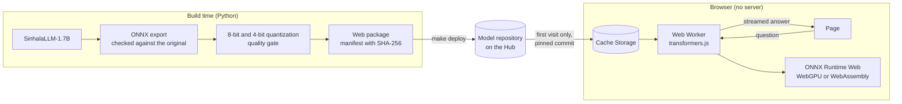

<div align="center">


# Offline සිංහල

**Sinhala question answering that runs fully offline in your browser**

[](https://huggingface.co/spaces/sinsankio/sinhalalm-offline)
[](https://huggingface.co/spaces/sinsankio/sinhalalm-offline-article)
[](https://huggingface.co/sinsankio/sinhalallm-1.7b-onnx-web)
[](https://huggingface.co/datasets/sinsankio/sinhalallm-1.7b-onnx-web-results)
[](CHANGELOG.md)
[](https://github.com/sinsankio/sinhalalm-offline/actions/workflows/ci.yml)
[](https://github.com/sinsankio/sinhalalm-offline/actions/workflows/live.yml)

[Overview](#overview) · [On Hugging Face](#on-hugging-face) · [Results](#results) · [Getting started](#getting-started) · [Deployment](#deployment) · [Documentation](#documentation)

</div>

## Overview

For a long period of time, running a language model meant sending text to a server and waiting for a response. This project runs [SinhalaLLM-1.7B](https://huggingface.co/namindu94/SinhalaLLM-1.7B), an open, instruction-tuned Sinhala model by Namindu Sanchila Nadeeshan, entirely inside the browser for single-turn Sinhala question answering. After the model is downloaded once, no server and no network connection are needed.

Rather than porting a custom runtime, the project treats the deployment as a sequence of verifiable transformations: each step must reproduce the output of the previous one before the next step begins.

- **Faithful conversion.** The model is exported to ONNX and checked against the original after every step, down to identical greedy answers in the browser and in Python.
- **Small enough to download.** An 8-bit model (2.48 GB) and a 4-bit model (1.19 GB), both checked against the author's own 4-bit release and reviewed by a native speaker.
- **Fast on WebGPU.** About 26 tokens per second on a laptop GPU, with WebAssembly as a slow fallback for browsers without one.
- **Sinhala-aware text handling.** The invisible zero-width joiner (ZWJ) in conjuncts such as ශ්‍රී is matched to the 15 clusters the model learned with it, so text typed without it reaches the model as it was trained.
- **Truly offline.** A service worker keeps the application available, and the model files are streamed into Cache Storage with a SHA-256 check of every file.

> [!WARNING]
> SinhalaLLM-1.7B often gets facts wrong from memory. Its answers are unverified, and it is not suitable for medical, legal or financial questions.

## On Hugging Face

| | Link | What it is |
|---|---|---|
| Application | [sinsankio/sinhalalm-offline](https://huggingface.co/spaces/sinsankio/sinhalalm-offline) | The live application, as a static Space |
| Article | [sinsankio/sinhalalm-offline-article](https://huggingface.co/spaces/sinsankio/sinhalalm-offline-article) | How it was built, step by step, with diagrams |
| Model files | [sinsankio/sinhalallm-1.7b-onnx-web](https://huggingface.co/sinsankio/sinhalallm-1.7b-onnx-web) | The browser-ready 8-bit and 4-bit ONNX models, loadable with transformers.js |
| Results | [sinsankio/sinhalallm-1.7b-onnx-web-results](https://huggingface.co/datasets/sinsankio/sinhalallm-1.7b-onnx-web-results) | Quality of every quantized variant tried, and browser speed and memory |
| Collection | [Offline Sinhala question answering in the browser](https://huggingface.co/collections/sinsankio/offline-sinhala-question-answering-in-the-browser) | All of the above, with the original model, on one page |

## How it works



1. **Build time.** The model is loaded with a corrected configuration, exported to ONNX, quantized and packaged. Operators that the browser runtime lacks, or runs on the processor instead of the GPU, are rewritten into equivalent standard ones with identical logits.
2. **First visit.** The application asks before downloading, then streams the model files from the model repository into Cache Storage, checking each file's SHA-256 against the manifest. The 8-bit model is the default on hardware WebGPU, and the 4-bit model is used otherwise or when the 8-bit model cannot be stored or loaded.
3. **Every visit after that.** The service worker serves the application and the worker loads the model from the cache, so questions are answered on the device without a connection.

## Results

Quality on the 1,012 sentences of the FLORES+ Sinhala test set (lower perplexity is better):

| Model | Download | Perplexity | Change |
|---|---|---|---|
| Original, fp32 | 6.96 GB | 113.2 | — |
| 8-bit (default on WebGPU) | 2.48 GB | 115.5 | +2.0% |
| 4-bit (fallback) | 1.18 GB | 158.0 | +39.6% |
| Author's Q4_K_M release (reference) | 1.08 GB | 195.0 | +72.2% |

Speed and memory in Chrome on a laptop with a mid-range NVIDIA GPU:

| Model and backend | Median speed | Median first token | Page memory |
|---|---|---|---|
| 4-bit, WebGPU | 26.5 tokens/s | 69 ms | 0.09 GB |
| 8-bit, WebGPU | 26.6 tokens/s | 76 ms | — |
| 4-bit, WebAssembly | 0.5 to 0.6 tokens/s | — | 1.78 GB |

All results, including every quantized variant that was tried, are in the [results dataset](https://huggingface.co/datasets/sinsankio/sinhalallm-1.7b-onnx-web-results) and in [FINDINGS.md](FINDINGS.md).

## Getting started

### Prerequisites

- [uv](https://docs.astral.sh/uv/) and Python 3.12
- Node.js 22 or later (npm 11 is pinned through `npx` in the Makefile)
- `make`
- Google Chrome, for the browser tests

### Run the application locally

```bash
make setup    # install the Python and Node dependencies
make package  # build and package the models (runs the pipeline below)
make preview  # production build on http://localhost:4173
```

`make dev` starts a development server on http://localhost:5173, but offline mode needs the production build, since the development server does not register the service worker.

> [!TIP]
> Chrome on Linux does not enable WebGPU by default, so the application falls back to the much slower WebAssembly backend. To use the GPU, quit Chrome completely and start it with a separate profile:
>
> ```bash
> google-chrome --user-data-dir=$HOME/.sinhalalm-chrome \
>   --enable-unsafe-webgpu --enable-features=Vulkan --use-angle=vulkan
> ```
>
> These flags enable WebGPU features that Chrome has not yet approved for Linux, so use this profile only for this application.

### The build pipeline

The pipeline runs locally through the Makefile, and every step must pass its check before the next one runs. The first run downloads SinhalaLLM-1.7B (about 3.5 GB) at a pinned revision and verifies the SHA-256 hash of every file.

<details>
<summary>All pipeline targets</summary>

```bash
make golden         # reference outputs with the reference toolchain (transformers 5.19.0)
make convert        # verify the export toolchain (transformers 4.57.6) against the reference
make test-web       # web unit tests, including tokenizer parity on 10,000 sentences
make onnx           # export fp32 ONNX and check it against the original (needs about 11.5 GB of free memory)
make quantize       # build the fp16, 8-bit and 4-bit variants (needs about 13 GB of free memory)
make quality        # quality gates against the author's Q4_K_M release (the 8-bit gate takes about an hour)
make package        # package the 8-bit and 4-bit models for the web application
make check-package  # verify the packaged model in transformers.js against Python
make e2e            # browser tests in Chrome, including identical answers and offline mode
make rq1            # perplexity and answer agreement of every variant (slow; needs FLORES+ access)
make dataset        # export the results as dataset tables
make verify         # rerun the reference outputs and the first check from scratch
make ci             # the whole local CI pipeline
make help           # list all targets
```

</details>

The pipeline uses two Python environments from the same `uv` project, since the model was saved with `transformers` 5.19.0 while the ONNX exporter requires 4.57.6. `make setup` creates both: `.venv` for the export toolchain and `.venv-reference` for the reference. `make ci` reruns a step only when the content of its inputs changes, using content hashes in `build/stamps/`.

> [!NOTE]
> Checkpoints, converted models and generated logits are large, so they live in a model store outside the repository. It defaults to `build/`, and a `local.mk` file (not committed) can point it elsewhere, for example to an external drive with `MODEL_STORE := /media/<user>/<drive>/sinhalalm-web`. The web application loads the packaged model through the link `web/public/models/sinhalallm-1.7b`, so the store must be available while the application runs locally.

## Deployment

```bash
git tag -a v0.1.0 -m "..."  # deploy needs a version tag on the current commit
make deploy                  # make ci, then the models to the model repository and the application to the Space
make e2e-live                # the browser tests against the deployed Space
make article                 # publish the article as its own static Space
```

`make deploy` needs a Hugging Face write token. It uploads the model package and its card to the model repository, builds the application pinned to the last commit that changed the model files, and uploads the application to the static Space. A Space holds at most 1 GB, so the models live in their own repository, and pinning to that commit means a card or image update never makes readers download the model again. The hosting checks and the problems the live tests found are recorded in [hosting.md](docs/findings/hosting.md).

## Project structure

```
sinhalalm-web/
├── .github/workflows/  # CI checks and live browser tests on GitHub
├── convert/          # build-time pipeline: conversion, export, quantization, evaluation
├── golden/           # fixtures shared by the Python and JavaScript tests
├── deploy/           # deployment scripts and the model, Space, dataset and article cards
├── docs/             # project proposal and per-topic findings
│   └── community/    # the article, its diagrams and the publishing steps
├── web/
│   ├── src/text/     # ZWJ handling and HTML entity decoding
│   ├── src/worker/   # inference worker: download, variants, generation
│   ├── src/ui/       # React interface: Ask and Diagnostics tabs
│   ├── src/sw/       # service worker template for offline mode
│   ├── tests/        # unit tests, tokenizer and package parity
│   └── e2e/          # Playwright browser tests
└── Makefile          # local CI pipeline
```

## Project status

| Phase | Scope | Status |
|---|---|---|
| 0 | Project bootstrap and toolchain checks | Done |
| 1 | Model selection, reference outputs and configuration translation | Done |
| 2 | Tokenizer parity and ZWJ handling | Done |
| 3 | ONNX export, quantization and the quantization quality study | Done |
| 4 | Browser application, offline mode, Diagnostics tab and acceptance targets | Done |
| 5 | Hosting checks and deployment to a Hugging Face static Space | Done |
| 6 | Speed benchmarks on more devices and a native-speaker evaluation of the ZWJ handling | Planned |

Every feature or fix is developed on its own branch and merged into `main` only after `make ci` passes, and features visible in the browser are also tested manually before they are merged.

GitHub Actions runs the parts of the pipeline that need no model weights:

- **CI**, on every push to `main` and every pull request: linting, the web unit tests with tokenizer parity on 10,000 sentences, and the production build.
- **Live Space**, every Monday and on demand: the browser tests against the deployed Space, which download the 4-bit model from the Hub at its pinned commit.

The conversion, quantization and quality gates need the model store and more memory than a hosted runner has, so they run locally with `make ci`.

## Documentation

- [Project proposal](docs/sinhalalm-browser-proposal.md): the full design, requirements and acceptance targets
- [FINDINGS.md](FINDINGS.md): a summary of every finding, with one document per topic in [docs/findings/](docs/findings/)
- [Article](https://huggingface.co/spaces/sinsankio/sinhalalm-offline-article): the project explained for a wider audience, with worked examples and diagrams
- [Model selection](docs/findings/model-selection.md): why the project moved from the HelaAI SinhalaLM models to SinhalaLLM-1.7B
- [Model outputs](docs/model-outputs.md), [quantization comparison](docs/quantization-comparison.md) and [model comparison](docs/model-comparison.md): the answers behind the evaluations
- [CHANGELOG.md](CHANGELOG.md): every change, including the attempts that were revised or rejected

## Credits

- [SinhalaLLM-1.7B](https://huggingface.co/namindu94/SinhalaLLM-1.7B) by Namindu Sanchila Nadeeshan (Apache-2.0), built on [SmolLM2-1.7B](https://huggingface.co/HuggingFaceTB/SmolLM2-1.7B) by Hugging Face. The author's Q4_K_M release served as the quality reference.
- [FLORES+](https://huggingface.co/datasets/openlanguagedata/flores_plus) by the Open Language Data Initiative (CC BY-SA 4.0), for the quality evaluation.
- [transformers.js](https://github.com/huggingface/transformers.js) and [Optimum](https://github.com/huggingface/optimum-onnx) by Hugging Face, and [ONNX Runtime](https://github.com/microsoft/onnxruntime) by Microsoft, for the export, quantization and browser runtime.
- The earlier stages of the project used the HelaAI SinhalaLM models ([base](https://huggingface.co/HelaAI/SinhalaLM-V.0.0.1) and [instruct](https://huggingface.co/HelaAI/SinhalaLM-V.0.0.1-it)).
