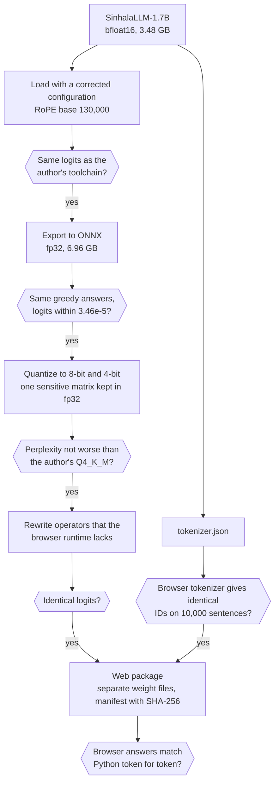

# SinhalaLLM-1.7B for the browser (ONNX)

Converted and quantized ONNX versions of [SinhalaLLM-1.7B](https://huggingface.co/namindu94/SinhalaLLM-1.7B) (version 2.1, revision `{revision}`) by Namindu Sanchila Nadeeshan, for [Offline සිංහල](https://huggingface.co/spaces/{space}), an application that answers Sinhala questions inside the browser with transformers.js. Once the files are downloaded, no server and no network connection are needed.

How these files were made is explained in the [article](https://huggingface.co/spaces/sinsankio/sinhalalm-offline-article), the evaluation results are in the [results dataset](https://huggingface.co/datasets/sinsankio/sinhalallm-1.7b-onnx-web-results), and the source code is on [GitHub](https://github.com/sinsankio/sinhalalm-offline).

### Variants

| Variant | Files | Download | Perplexity on FLORES+ (1,012 sentences) |
|---|---|---|---|
| 8-bit (`q8`), default on WebGPU | `onnx/model_quantized.onnx` with two data files | 2.48 GB | 115.5 (+2.0% against fp32) |
| 4-bit (`q4`), fallback | `onnx/model_q4.onnx` with one data file | 1.18 GB | 158.0 (+39.6% against fp32) |

For comparison, the original model in fp32 has a perplexity of 113.2 on the same sentences, and the author's 4-bit GGUF release (Q4_K_M) 195.0. Lower is better. Both variants were shipped only after passing two conditions: a perplexity no higher than the author's Q4_K_M release on the same sentences, and a review of their answers by a native speaker. `manifest.json` lists the size and SHA-256 hash of every file.

### Usage with transformers.js

```js
import { AutoModelForCausalLM, AutoTokenizer, TextStreamer } from "@huggingface/transformers";

const repo = "sinsankio/sinhalallm-1.7b-onnx-web";
const tokenizer = await AutoTokenizer.from_pretrained(repo);
const model = await AutoModelForCausalLM.from_pretrained(repo, {
  device: "webgpu",
  dtype: "q8", // or "q4"
  use_external_data_format: 2, // 1 for "q4"
});

const inputs = tokenizer.apply_chat_template(
  [{ role: "user", content: "ශ්‍රී ලංකාවේ අගනුවර කුමක්ද?" }],
  { add_generation_prompt: true, return_dict: true },
);
await model.generate({
  ...inputs,
  max_new_tokens: 256,
  do_sample: true,
  temperature: 0.7,
  top_k: 50,
  repetition_penalty: 1.1,
  streamer: new TextStreamer(tokenizer, { skip_prompt: true, skip_special_tokens: true }),
});
```

- The sampling settings above are the defaults of Offline සිංහල.
- Keep the question and the answer within 1,024 tokens. The model was trained with a context of 2,048 tokens.
- Generation stops at `<|im_end|>` or `<|endoftext|>`, which `generation_config.json` lists.
- To pin a revision, also write it into `env.remotePathTemplate` (for example `{model}/resolve/<commit>/`). transformers.js 4.3.1 checks for `tokenizer_config.json` without the revision passed to `from_pretrained`, so it would read that file from `main`, and fail offline.
- On WebAssembly (no GPU), use `q4`. The 8-bit model has no fast WebAssembly kernel, and the 4-bit model generates about 0.5 to 0.6 tokens per second there.

### Sinhala input: the zero-width joiner

Sinhala conjuncts such as ශ්‍රී are written with an invisible zero-width joiner (ZWJ), which many keyboards leave out. The tokenizer does not add it back. For example, the same three words typed two ways:

- With the ZWJ, ශ්‍රී ලංකාව ප්‍රධාන is 3 tokens.
- Without it, ශ්රී ලංකාව ප්රධාන is 6 tokens.

The vocabulary contains exactly 15 clusters with the ZWJ, and other clusters only without it:

- With the ZWJ: ප්‍ර, ත්‍ර, ක්‍ර, ග්‍ර, ශ්‍ර, ද්‍ර, ඝ්‍ර, ධ්‍ය, ද්‍ය, ශ්‍ය, ජ්‍ය, ඛ්‍ය, භ්‍ය, ට්‍ය, ෂ්‍ය
- Without it: every other cluster of a virama followed by ර or ය, such as ව්ය and ත්ය

Offline සිංහල adds the ZWJ in the 15 clusters and removes it everywhere else before tokenizing. On 10,000 Sinhala sentences:

- This rule reduced the number of tokens by 1.57%.
- On text typed without the ZWJ, it reduced them by 10.4%.
- Adding the ZWJ to every cluster instead increased them by 0.26%.

### How the files were made




1. **Configuration.** The original configuration was saved with `transformers` 5.19.0, and `transformers` 4.57.6, which the ONNX exporter requires, reads its RoPE base as 10,000 instead of 130,000 without any error. The export uses a corrected configuration, and its logits match the original exactly.
2. **Export.** The model was exported to ONNX in fp32 with a key-value cache. Its greedy answers match the original on ten test questions, with logits within 3.46e-5 of each position's largest logit.
3. **Quantization.** Both variants use ONNX Runtime's block quantizers. Plain 4-bit quantization raised the perplexity by 164% or more, and a search showed that most of the loss comes from one 2048 × 2048 matrix, the value projection of the first layer. The 4-bit variant keeps that matrix in fp32, which costs 16 MB.
4. **Browser rewrites.** A few operators were replaced with equivalent standard ones, with identical logits: the 4-bit embedding lookup, which the browser build of ONNX Runtime does not implement, is written with standard operators, and the check for NaN after each softmax is written as `Not(Equal(x, x))`, so that it runs on the GPU.
5. **Packaging.** The weights are stored in separate data files, which keeps the browser's memory low (0.06 GB of page memory on WebGPU, against 2.67 GB with the weights inside the model file). The 8-bit weights are split into two files of 1.24 GB, since transformers.js did not finish loading a single file of 2.48 GB. The chat template is embedded in `tokenizer_config.json`, where transformers.js looks for it.
6. **Checks.** The browser tokenizer gives the same token IDs as the Python tokenizer on 10,000 Sinhala sentences, and in Chrome the greedy answers of the 4-bit model match ONNX Runtime in Python over the first 32 tokens of all ten test questions.

### Speed and memory

Measured in Chrome on a laptop with a mid-range NVIDIA GPU.

| Variant and backend | Median speed | Median first token | Page memory | Renderer process |
|---|---|---|---|---|
| 8-bit, WebGPU | 26.6 tokens/s | 76 ms | — | 1.99 GB |
| 4-bit, WebGPU | 26.5 tokens/s | 69 ms | 0.09 GB | 1.37 GB |
| 4-bit, WebAssembly | 0.5 to 0.6 tokens/s | 5.2 s for a 52-token question | 1.78 GB | 2.35 GB |

### Limitations

- The model often gets facts wrong from memory and is weak at multi-step arithmetic and reasoning. Its answers are not suitable for medical, legal or financial decisions.
- Chrome on Linux does not offer hardware WebGPU by default. Without it, the model runs on WebAssembly at about 0.5 to 0.6 tokens per second.
- All speed and memory figures come from one laptop.

### License and credits

Released under the Apache License 2.0, like the original model; see `NOTICE.txt`.

- **SinhalaLLM-1.7B** (version 2.1) by Namindu Sanchila Nadeeshan: [namindu94/SinhalaLLM-1.7B](https://huggingface.co/namindu94/SinhalaLLM-1.7B). The model, its Sinhala tokenizer, and the Q4_K_M release used as the quality reference.
- **SmolLM2-1.7B**, the base model of SinhalaLLM-1.7B: [HuggingFaceTB/SmolLM2-1.7B](https://huggingface.co/HuggingFaceTB/SmolLM2-1.7B). Allal et al., *SmolLM2: When Smol Goes Big — Data-Centric Training of a Small Language Model*, arXiv:2502.02737, 2025.
- **FLORES+** (`sin_Sinh` devtest) by the Open Language Data Initiative, CC BY-SA 4.0: [openlanguagedata/flores_plus](https://huggingface.co/datasets/openlanguagedata/flores_plus). NLLB Team et al., *No Language Left Behind: Scaling Human-Centered Machine Translation*, arXiv:2207.04672, 2022.
- **ONNX Runtime** by Microsoft, for quantization and the WebGPU and WebAssembly backends; **Optimum** by Hugging Face, for the export; **transformers.js** by Hugging Face, for running the model in the browser; **llama.cpp**, which made the Q4_K_M reference.
