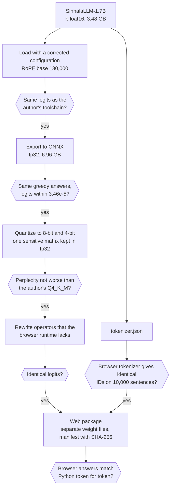
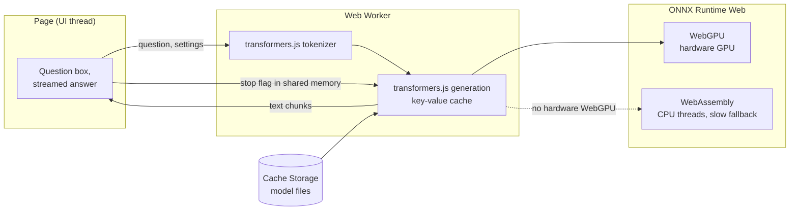
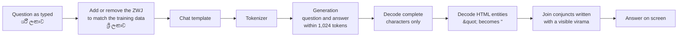
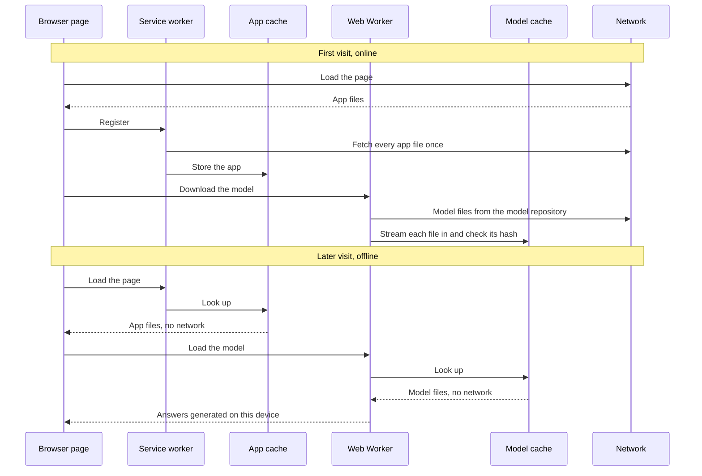
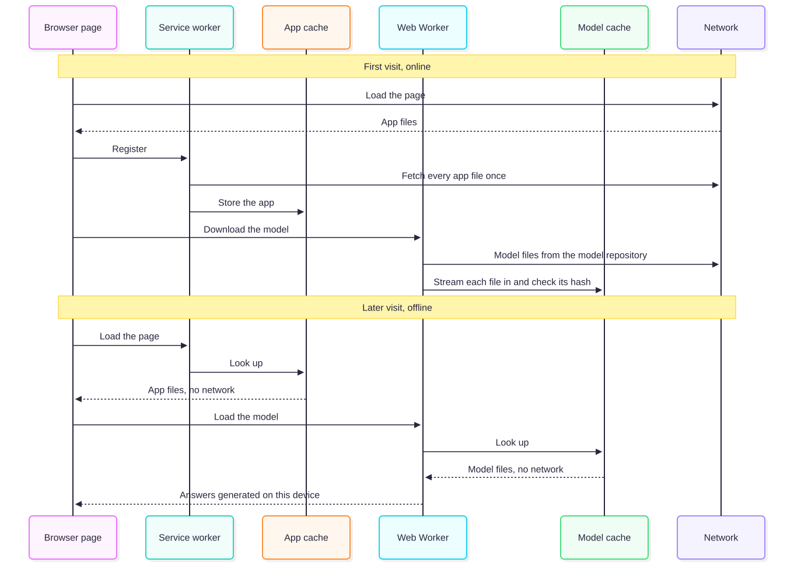
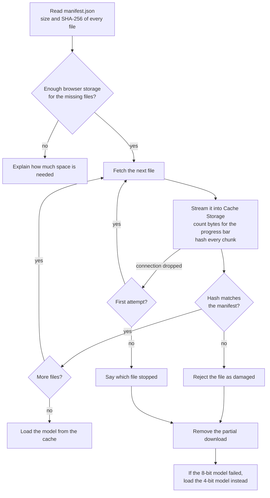
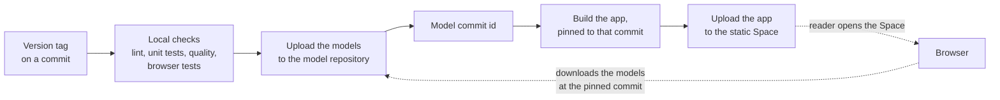

# Running a Sinhala Language Model Fully Offline in the Browser

For a long period of time, running a language model meant sending text to a server and waiting for a response. However, browsers can now reach the GPU through WebGPU, and small open models have become good enough to answer simple questions. This combination makes it possible to run a model entirely on the reader's own computer, with no server involved once the model is downloaded.

In this article, I break down how I built **Offline සිංහල**, an application that answers Sinhala questions inside the browser with [SinhalaLLM-1.7B](https://huggingface.co/namindu94/SinhalaLLM-1.7B), an open Sinhala model by Namindu Sanchila Nadeeshan. I cover how the model was moved into the browser without changing what it computes, how it was made small enough to download, the problems the browser runtime raised along the way, how the offline mode works and how the whole thing is hosted on Hugging Face.

- Try it: [Offline සිංහල on Hugging Face Spaces](https://huggingface.co/spaces/sinsankio/sinhalalm-offline)
- The browser-ready model files: [sinsankio/sinhalallm-1.7b-onnx-web](https://huggingface.co/sinsankio/sinhalallm-1.7b-onnx-web)
- The evaluation results as tables: [sinsankio/sinhalallm-1.7b-onnx-web-results](https://huggingface.co/datasets/sinsankio/sinhalallm-1.7b-onnx-web-results)
- The source code: [sinsankio/sinhalalm-offline](https://github.com/sinsankio/sinhalalm-offline) on GitHub

Rather than writing a custom runtime, I treated the deployment as a sequence of transformations, where each step must reproduce the output of the previous step before the next one begins. Throughout the article, one question follows the model through every step: a reader types ශ්‍රී ලංකාවේ අගනුවර කුමක්ද? ("What is the capital of Sri Lanka?"), and expects a correct Sinhala answer on screen without an internet connection.

### The Story

The project did not start with SinhalaLLM-1.7B. It started with the HelaAI SinhalaLM models ([base](https://huggingface.co/HelaAI/SinhalaLM-V.0.0.1) and [instruct](https://huggingface.co/HelaAI/SinhalaLM-V.0.0.1-it)), since their 32.85 million parameters made them an easy fit for a browser. Their conversion worked perfectly, with a logit difference of exactly 0.0 against the original. However, a model that fits the browser is only useful if its answers are useful, and on my test questions, none of the instruct model's answers addressed the question.

So I looked for a different model with the same goal in mind: Sinhala question answering that runs on the reader's device.

### Choosing the model

Before comparing answers, I measured how each candidate's tokenizer handles Sinhala. A **tokenizer** cuts text into the pieces (tokens) a model reads and writes, and the number of tokens per word matters twice in a browser: every token costs one step of generation, and fewer tokens means more text fits into the context.

| Tokenizer | Sinhala tokens per word |
|---|---|
| SinhalaLLM-1.7B | 1.76 |
| HelaAI SinhalaLM | 2.66 |
| [Gemma 4 E2B](https://huggingface.co/google/gemma-4-E2B-it) | 3.16 |
| [Qwen3.5](https://huggingface.co/Qwen/Qwen3.5-2B) | 4.92 |
| SmolLM2-1.7B (SinhalaLLM's base model) | 15.99 |

The last row highlights why the model is a good candidate. SinhalaLLM-1.7B is built on [SmolLM2-1.7B](https://huggingface.co/HuggingFaceTB/SmolLM2-1.7B), and its author extended the tokenizer with 14,192 Sinhala tokens. In other words, the same architecture needs about 9 times fewer tokens per Sinhala word after the extension.

On ten Sinhala questions, SinhalaLLM-1.7B was also the only screened model whose answers addressed the questions. [Qwen3.5-2B](https://huggingface.co/Qwen/Qwen3.5-2B) and [Qwen3.5-0.8B](https://huggingface.co/Qwen/Qwen3.5-0.8B) were mostly wrong and ran to the token limit. The downside is that SinhalaLLM-1.7B often gets facts wrong from memory, which its model card also states, so the application labels every answer as unverified.

### Moving the model without changing it

The model has 1.74 billion parameters and uses the standard Llama architecture, so no custom conversion was needed. The work was to make sure that each tool in the chain reads the model exactly as its author trained it, and to prove it with a check after every step.





*Conversion pipeline which demonstrates how each step must pass a check against the previous one before the next step begins.*

#### A) A setting that two library versions read differently

The model's configuration was saved with `transformers` 5.19.0, while the ONNX exporter requires 4.57.6. The newer version stores the **RoPE base** (a number that controls how the model encodes the position of each token) inside a nested field, which the older version does not read. Instead of failing, it silently falls back to its default: 10,000 instead of the trained 130,000.

This is the most dangerous kind of error, since nothing breaks. With the wrong value, the model still loads and writes fluent Sinhala, and the answers to two of my test questions were identical or differed by a single word. Only a longer answer fell into repetition. Measured directly, the logits (the scores the model gives every possible next token) differed by up to 11.66.

The pipeline therefore writes a corrected configuration for the exporter, and a check compares its output against the author's own toolchain. With the correction, the difference is exactly 0.0.

#### B) Exporting to ONNX

The browser runtime reads models in the **ONNX** format, a portable description of the model's computation. Exporting a 1.74B model in one pass needs more memory than a typical workstation has free, so the export runs as a memory-capped process that writes one file per weight, followed by a separate step that checks every file and joins them. The size of the result confirms that nothing was lost or duplicated:

- The model has 1,740,474,368 parameters.
- In fp32, each parameter takes 4 bytes.
- 1,740,474,368 × 4 = 6,961,897,472 bytes, which is exactly the size of the final data file.

In other words, the exported model contains every parameter once and nothing else.

The exported model gives the same greedy answers as the original on all test questions, and its logits differ by at most 3.46e-5 of each position's largest logit, which is the size of rounding differences between two math libraries.

#### C) The tokenizer in the browser

The browser can only reproduce the model if it turns text into exactly the same token IDs. The tokenizer of transformers.js produced identical token IDs to the Python tokenizer on 10,000 Sinhala sentences from four public sources and on 17 hand-written edge cases, including invisible characters that Python and JavaScript treat differently.

One file was missing, though. The model stores its chat template (the format that wraps a question before the model sees it) in a separate file that the browser tokenizer does not read. The first test failed with "Cannot use apply_chat_template() because tokenizer.chat_template is not set", so the packaging step now embeds the template where the browser looks for it.

### Making it smaller: quantization and quality

At full precision, the model is 6.96 GB, which is far too large to download into a browser. **Quantization** stores each weight with fewer bits. A weight in fp32 takes 4 bytes, an 8-bit weight takes 1 byte and a 4-bit weight takes half a byte. Since a 4-bit number can only take 16 different values, the weights are grouped into blocks of 32, and each block stores one scale that maps those 16 values back to the real range.

*Example.* How the 4-bit model reaches its size:

- Start with 1,740,474,368 parameters.
- At 4 bits, each takes half a byte, so the weights alone come to about 0.87 GB.
- Add one scale for every block of 32 weights.
- Add the few parts kept at higher precision.
- The result is the shipped 4-bit model: 1.18 GB.

The cost of quantization is quality, which I measured with **perplexity** on the 1,012 Sinhala sentences of the FLORES+ test set. Perplexity describes how surprised the model is by real text, so lower is better.

#### One matrix caused most of the loss

The first 4-bit models lost far more than expected. Perplexity rose by 164% to 248% across every setting I tried, including different block sizes, asymmetric quantization and the HQQ method. To find out whether my pipeline was at fault, I evaluated the author's own 4-bit release (a Q4_K_M file made with llama.cpp, which mixes 4-bit and 6-bit weights) on the same sentences. It lost 51.5% on the same subset, so the sensitivity belongs to the model rather than to the pipeline.

The cause came out of a simple search:

- Quantize the whole model to 4 bits, except one group of weights kept at full precision.
- Measure the perplexity again.
- Repeat with the next group, and compare.

A single 2048 × 2048 matrix, the value projection of the first layer, accounted for most of the loss. Keeping just that matrix at full precision costs 16 MB and reduced the perplexity on 50 sentences from 279.2 to 143.2.

| Model | Download | Perplexity (1,012 sentences) | Change |
|---|---|---|---|
| Original, fp32 | 6.96 GB | 113.2 | — |
| 8-bit | 2.48 GB | 115.5 | +2.0% |
| 4-bit, first value projection at full precision | 1.18 GB | 158.0 | +39.6% |
| Author's Q4_K_M release | 1.08 GB | 195.0 | +72.2% |

The quality rule for shipping became: no worse than the author's own 4-bit release on the same sentences, plus a review of the answers by a native speaker. Both shipped models passed both parts.

### Making it run in the browser

In the browser, the page hands the question to a **Web Worker**, a background thread, so that the page stays responsive while the model generates. The worker runs the tokenizer and the generation through transformers.js, which in turn runs the model with ONNX Runtime Web, on the GPU through WebGPU or on the processor through WebAssembly.





*Browser runtime which represents how the question, the model and the answer move between the page, the worker and ONNX Runtime Web.*

Every check so far had run in Python or Node.js. The browser build of the runtime then raised six problems that none of those checks could see.

#### A) A missing operator

The first browser test failed before generating a single token:

```
Could not find an implementation for GatherBlockQuantized(1) node with name '/model/embed_tokens/Gather_Q4'
```

The 4-bit quantizer stores the **embedding** (the table that turns each token ID into a vector) with a special operator that the Python and Node.js runtimes support, but the browser build does not. So the pipeline now replaces it with standard operations that compute the same values.

*Example.* Two 4-bit codes share one byte. Suppose a block holds the codes −3 and 5.

- **Store:** add an offset of 8 to each code, so −3 becomes 5 and 5 becomes 13.
- **Pack:** put both into one byte as 13 × 16 + 5 = 213.
- **Recover the first code:** 213 mod 16 = 5, and 5 − 8 = −3.
- **Recover the second code:** 213 ÷ 16 = 13 (whole part), and 13 − 8 = 5.
- **Scale:** multiply both codes by their block's scale.

The browser runs these steps with ordinary arithmetic. The rewritten model gives identical logits and the same perplexity, and the packaging step now refuses any model that still contains an operator the browser lacks.

#### B) Two operators that stalled the GPU

On a laptop GPU, the first answers came at 4.6 to 6.3 tokens per second, against a target of 20. The runtime's log showed two operators running on the processor, which forced the GPU to wait for a copy many times per token.

The first one was a check for invalid numbers (`IsNaN`) after every attention step in all 24 layers, which the WebGPU backend does not implement. The replacement relies on a property of floating-point numbers:

- NaN is the only value that is not equal to itself.
- So for any number x, `Equal(x, x)` is false exactly when x is NaN.
- `IsNaN(x)` therefore becomes `Not(Equal(x, x))`, and both of those operators run on the GPU.

The second one was the bit unpacking of the embedding from the previous section, which now uses integer division and subtraction.

| Model, plain runtime session | Time per token | Tokens per second |
|---|---|---|
| Before the rewrites | 245 ms | 4.1 |
| Invalid-number check replaced | 58 ms | 17.2 |
| Both replaced | 53 to 57 ms | 17.5 to 18.9 |

In the application, where transformers.js also keeps the key-value cache on the GPU, a 64-token answer was generated at 27.6 tokens per second, with the first token after 0.1 s.

#### C) WebAssembly has no fast 4-bit kernel

Without a GPU, the model generated 0.6 tokens per second on the processor, even with multiple threads. A profile attributed 94% of the time to the 4-bit matrix product, which the WebAssembly build does not optimize. To put this into perspective, take a 50-word answer:

- At 1.76 tokens per word, it is about 88 tokens.
- On WebGPU at 26.5 tokens per second, it takes about 3.3 s.
- On WebAssembly at 0.6 tokens per second, it takes about 2.5 minutes. I kept WebAssembly as a slow fallback for browsers without a usable GPU, rather than adding a second, larger download that would suit it better.

#### D) Chrome on Linux hides the GPU

On Linux, Chrome offers no hardware WebGPU by default, and only a software adapter with one flag. A software adapter runs on the processor and would be slower than WebAssembly, so the application rejects it. With `--enable-unsafe-webgpu --enable-features=Vulkan --use-angle=vulkan`, Chrome finds the hardware GPU. The application now explains this on Linux and shows the command.

#### E) Weights inside the model file doubled the memory

With the weights inside the ONNX file, the runtime read the whole file into its WebAssembly memory and kept a second copy, and WebAssembly memory never shrinks. Storing the same weights in a separate data file removed the copy, without changing a single value.

| 4-bit model, same answer | Page memory |
|---|---|
| Weights inside the model file, WebGPU | 2.67 GB |
| Separate data file, WebGPU | 0.06 GB |
| Separate data file, WebAssembly | 1.88 GB |

#### F) Large files need care

Two more problems came from file sizes. transformers.js never finished loading the 8-bit model's single 2.48 GB data file, while two files of 1.24 GB loaded in 13 s. And Chrome failed to cache the 1.18 GB data file from memory, so the worker now downloads the files itself and streams them into the cache, which is the basis of the offline mode below.

#### The text around the model

Sinhala conjuncts such as ශ්‍රී are written with an invisible character, the **zero-width joiner (ZWJ)**. Many keyboards leave it out, and the model's tokenizer does not add it back.

*Example.* The same three words, typed two ways:

- With the ZWJ, ශ්‍රී ලංකාව ප්‍රධාන is 3 tokens.
- Without it, ශ්රී ලංකාව ප්රධාන is 6 fragments that the model rarely saw in training.

The obvious fix, adding the ZWJ before every ර and ය, turned out to be wrong for this model. Its vocabulary has exactly 15 clusters with the ZWJ (such as ප්‍ර and ද්‍ය), and other clusters (such as ව්ය) only without it. So the application adds or removes the ZWJ to match that split. On 10,000 sentences:

- The obvious rule made the text 0.26% longer in tokens.
- The matching rule made it 1.57% shorter.
- On text typed without the ZWJ, the matching rule made it 10.4% shorter. In the output, all 143 conjuncts in 25 answers (1,409 words) already carried the ZWJ, so the display step that joins conjuncts written with a visible virama acts as a safety net.




*Text processing around the model, which illustrates how the reader's question is matched to the training data and how the answer stays intact while it streams.*

For our reader's question, step by step:

- The reader types ශ්රී ලංකාවේ අගනුවර කුමක්ද? without the ZWJ.
- The application adds the ZWJ, since ශ්‍රී is one of the 15 clusters the model learned with it.
- The model receives ශ්‍රී, exactly as it learned it.
- The question on screen stays as typed.

### Working offline

The offline mode depends on two caches. A **service worker** (a small script the browser runs between the page and the network) stores the application's own files on the first visit and serves them on every later visit. The model files go into **Cache Storage**, where they stay until the reader deletes them from the application.





*First online visit and a later offline visit, which demonstrates how the app cache and the model cache together let the application answer without a network.*

The download itself is built to fail safely:

- The worker reads a manifest with the size and SHA-256 hash of every file.
- It checks that the browser allows enough storage for the missing files.
- It streams each file into the cache and hashes every chunk on the way.
- A file whose hash does not match is rejected as damaged.
- A dropped connection gets one retry.
- A failed download is removed rather than left half-stored.

The application also asks the browser to keep its storage persistent, which reduces the chance that the model is evicted.





*Model download which represents how every file is checked while it streams into the cache, and what happens when a file is damaged or the connection drops.*

The 8-bit model is the default on computers with hardware WebGPU, since it is as fast as the 4-bit model there (26.6 against 26.5 tokens per second) and closer to the original. If it cannot be downloaded, stored or loaded, the application removes its partial files, loads the 4-bit model instead and says why. Without hardware WebGPU, the 4-bit model is the default.

### Hosting on a static Space

The application is a set of static files, so it is hosted on a Hugging Face static Space. Two things had to be confirmed on the real host rather than on a local server.

The first was **cross-origin isolation**. Multi-threaded WebAssembly needs shared memory between threads, which browsers only allow on pages served with two specific headers. A static Space accepts them through its configuration, and on the live Space the page reported `crossOriginIsolated` as true, the service worker took control after the first reload, and the page reloaded without a connection.

The second was size. My first deployment uploaded the application together with the models, and failed:

```
403 Forbidden: Storage limit reached for this space (Max: 1 GB)
```

The 4-bit model alone is 1.18 GB, so the models now live in their own model repository, and the Space holds only the application. Every release then runs in order:

- Upload the models to the model repository.
- Read the commit of the last change to the model files.
- Build the application pinned to that commit.
- Upload the application to the Space.

In other words, a released application always downloads exactly the model files it was tested with.




*Deployment which demonstrates how a version tag leads to a model upload, an application build pinned to that model commit and an upload to the Space.*

The live tests found four more problems that a local server never shows:

- **A dropped connection looked like a full disk.** Chrome reports a connection that drops during a download with the same error as a full disk, so a reader with plenty of free space was told that the model could not be stored. The application now retries the file once, and if it fails again, it names the file that stopped.
- **No progress bar.** The Hub sends `tokenizer.json` compressed, without a size header, so the total size stayed unknown and the progress bar never appeared. The worker now takes every file size from the manifest.
- **The model did not load offline.** transformers.js 4.3.1 checks for `tokenizer_config.json` without the pinned commit, so it asked the Hub for the latest version of that file. Offline, the request failed and the model did not load. The worker now writes the pinned commit into every address it asks for.
- **A card change would have re-downloaded the model.** The application was pinned to the latest commit of the model repository, so a commit that changed only the model card would have given it a new revision, and every reader's browser would have downloaded the model again. It is now pinned to the last commit that changed the manifest, which lists the hash of every model file.

A first download takes a while on a slow connection, which is why the application asks before it downloads and shows its progress. After these fixes, the browser tests passed against the live Space: the download with its progress bar, browser answers that match Python token for token, streaming and stopping an answer, the check for a question longer than the context, and a reload that keeps the model. With the connection switched off, the application reloaded from the cache and answered, and deleting the model left nothing behind, so a new download needed the connection again.

### Results

All measurements below come from Chrome on a laptop with a mid-range NVIDIA GPU, with the 4-bit model unless stated otherwise.

| Target | WebGPU | WebAssembly |
|---|---|---|
| Download at most 1.2 GB (4-bit) | 1.18 GB | 1.18 GB |
| Page memory at most 2 GB | 0.09 GB | 1.78 GB |
| Warm load at most 10 s | 3.7 s + 0.7 s warm-up | 2.8 to 3.2 s + 4.1 to 5.3 s warm-up |
| First token of a 52-token question | 484 ms (target 1 s) | 5.2 s (no target) |
| Speed | 26.5 to 27.3 tokens/s (target 20) | 0.5 to 0.6 tokens/s (no target) |

The 8-bit model reached 26.6 tokens per second with its first token after a median of 76 ms, at a download of 2.48 GB. Beyond speed, the answers in Chrome matched the Python runtime token for token over the first 32 tokens of all ten test questions, so the browser adds no drift of its own.

### What's next

Two questions remain open. The first is how fast the application runs on other devices and browsers, since every number above comes from one laptop. The second is whether the ZWJ handling improves the answers as rated by native speakers, rather than only reducing the number of tokens, and whether any words need a visible virama that the display step would join.

### Remarks

Throughout this project, the strongest takeaway for me is this: in a model deployment, the dangerous errors are the silent ones. A wrong RoPE base, a missing chat template, a dropped ZWJ, a misread error message or a request for the wrong version of one file all produced something that looked fine at first. A check after every step is what turned them into findings instead of wrong answers on a reader's screen.

The model now runs fully offline in the browser, not just as a demo, but as an application that downloads once, verifies what it downloaded and keeps answering without a connection.

Thank you for reading!

### Credits & references

- **SinhalaLLM-1.7B** (version 2.1) by Namindu Sanchila Nadeeshan, Apache License 2.0: [namindu94/SinhalaLLM-1.7B](https://huggingface.co/namindu94/SinhalaLLM-1.7B). The model, its Sinhala tokenizer, and the Q4_K_M GGUF release used as the quality reference.
- **SmolLM2-1.7B** by Hugging Face, Apache License 2.0: [HuggingFaceTB/SmolLM2-1.7B](https://huggingface.co/HuggingFaceTB/SmolLM2-1.7B). Loubna Ben Allal, Anton Lozhkov, Elie Bakouch, Gabriel Martín Blázquez, Guilherme Penedo, Lewis Tunstall, et al. *SmolLM2: When Smol Goes Big — Data-Centric Training of a Small Language Model.* arXiv:2502.02737, 2025.
- **FLORES+** by the Open Language Data Initiative, CC BY-SA 4.0: [openlanguagedata/flores_plus](https://huggingface.co/datasets/openlanguagedata/flores_plus), the `sin_Sinh` devtest split. NLLB Team, Marta R. Costa-jussà, James Cross, Onur Çelebi, et al. *No Language Left Behind: Scaling Human-Centered Machine Translation.* arXiv:2207.04672, 2022.
- **llama.cpp** by the ggml authors: [ggml-org/llama.cpp](https://github.com/ggml-org/llama.cpp). The Q4_K_M quantization of the reference release.
- **transformers.js** by Hugging Face: [huggingface/transformers.js](https://github.com/huggingface/transformers.js). The tokenizer and generation in the browser.
- **ONNX Runtime** and **ONNX Runtime Web** by Microsoft: [microsoft/onnxruntime](https://github.com/microsoft/onnxruntime). The 8-bit and 4-bit quantizers, the reference runtime and the WebGPU and WebAssembly backends.
- **Optimum** by Hugging Face: [huggingface/optimum-onnx](https://github.com/huggingface/optimum-onnx). The ONNX export of the model.
- **Tokenizer test corpora**: [ChamaraVishwajithRajapaksha/sinhala-text-dataset](https://huggingface.co/datasets/ChamaraVishwajithRajapaksha/sinhala-text-dataset), [ChamaraVishwajithRajapaksha/sinhala-question-answer-pairs](https://huggingface.co/datasets/ChamaraVishwajithRajapaksha/sinhala-question-answer-pairs) (Apache 2.0), [ihalage/sinhala-finetune-qa-eli5](https://huggingface.co/datasets/ihalage/sinhala-finetune-qa-eli5) (MIT) and the Sinhala edition of [wikimedia/wikipedia](https://huggingface.co/datasets/wikimedia/wikipedia) (CC BY-SA 3.0 and GFDL).
