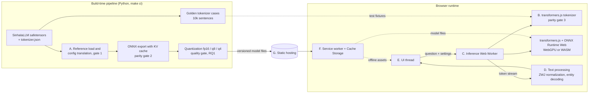
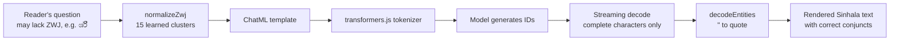
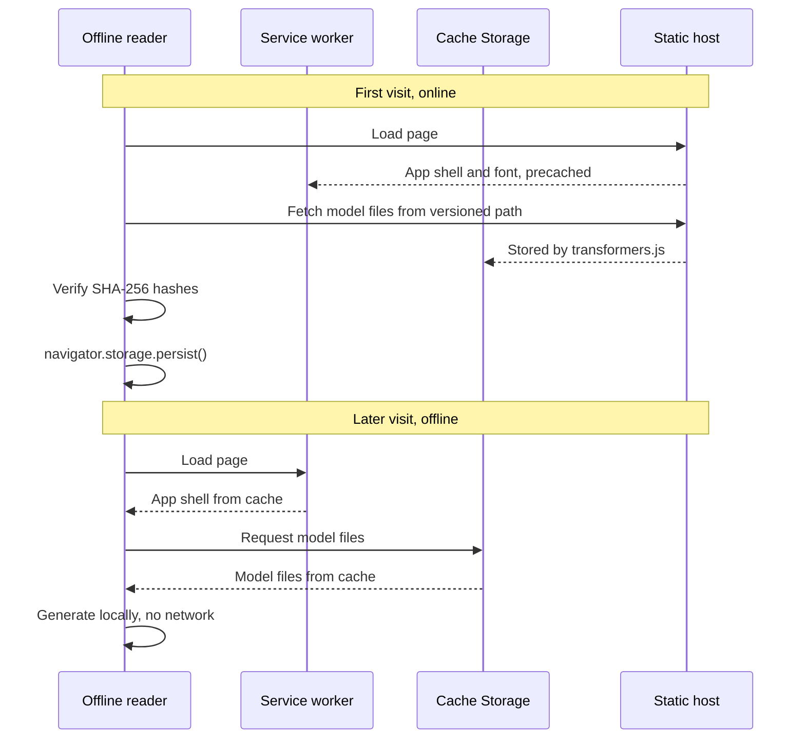
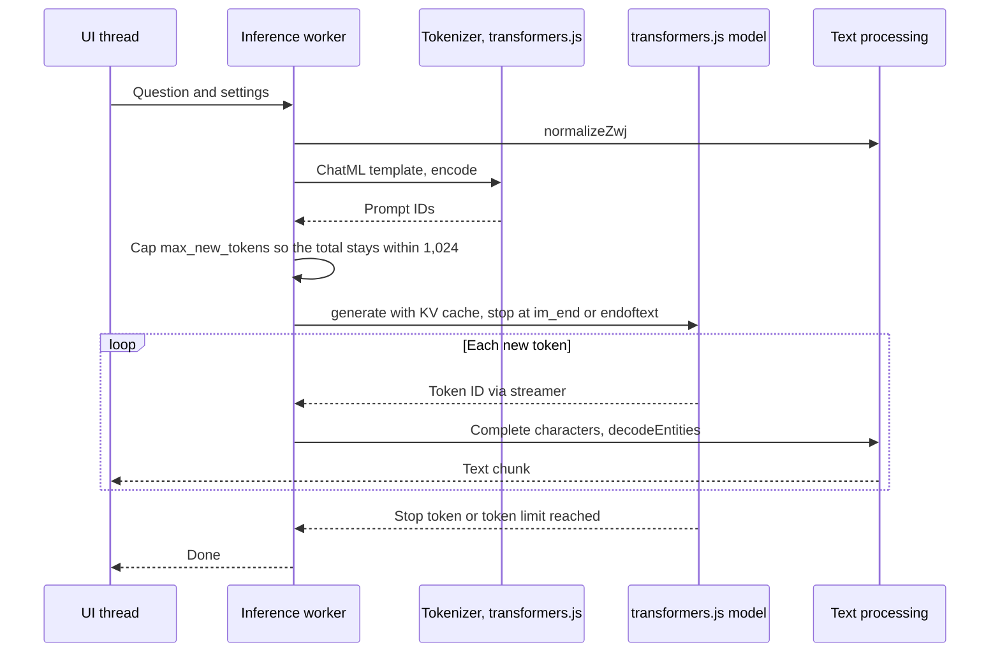
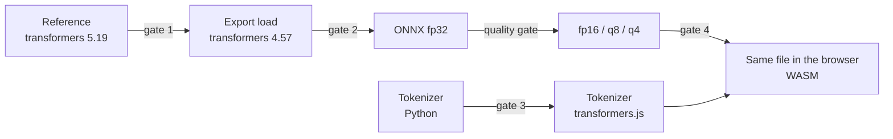
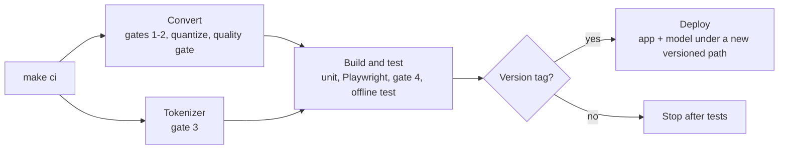

# End-to-End Fidelity in On-Device Language Models for Low-Resource Scripts: An Empirical Study of Sinhala in the Browser

*System design, implementation, testing and deployment plan for client-side Sinhala question answering*

---

### Abstract

For a long period of time, running a language model meant sending text to a server and waiting for a response. However, the combination of compact models, ONNX-based runtimes and WebGPU has begun to make it practical to run a model entirely inside a web browser, with no server and no network connection after the first download. SinhalaLLM-1.7B is an open, instruction-tuned language model built for Sinhala on top of SmolLM2-1.7B, with a Sinhala-aware tokenizer that extends the base vocabulary by 14,192 Sinhala tokens. At 1.74B parameters, it is small enough to be a candidate for client-side inference on desktop and laptop computers.

In this proposal, we present an end-to-end plan to run SinhalaLLM-1.7B offline in the browser for Sinhala question answering. The project first evaluated the HelaAI SinhalaLM models, whose answers did not reach a satisfactory question-answering quality, and then compared alternative models on the same Sinhala questions, where SinhalaLLM-1.7B was the only screened model whose answers addressed the questions. Before designing the system, we inspected its repository and found several issues that directly shape the design: a configuration that the export toolchain silently loads with the wrong RoPE base, a tokenizer that expects the zero-width joiner (ZWJ) although user input often omits it, and a context length that differs from the trained one. The proposed system addresses each of these through a configuration translation verified against the author's toolchain, explicit ZWJ normalization of the input and parity gates at every conversion step, and is evaluated on quantization quality, cross-device latency and ZWJ fidelity.

---

### 1. Introduction

Sinhala is spoken by over 20 million people, yet it remains comparatively under-served by mainstream multilingual language models. The common way to bring LLM capability to Sinhala has been continual pretraining of a large existing model, which requires substantial GPU memory and incurs high inference cost. SinhalaLLM-1.7B explores a smaller direction: a 1.7B model whose vocabulary was extended for Sinhala, and which its author reports at about one fifth of the memory of the 8B SinLlama model.

A model of this size does not just reduce server cost, but opens the possibility of removing the server altogether. Consider a scenario where a reader opens a web page once on Wi-Fi, installs it as an app, and later asks a Sinhala question while having no connection at all. In this proposal, we use this **offline reader** as the running example, and every design decision is evaluated against whether it serves that reader.

Rather than treating the browser deployment as a packaging exercise, we treat it as a sequence of verifiable transformations. Each step (reference loading, tokenization, ONNX export, quantization, in-browser execution) must reproduce the output of the previous step within a defined tolerance before the next step begins.

The objectives of this work are:

- To load SinhalaLLM-1.7B in the export toolchain without any loss of fidelity relative to the toolchain the model was published with.
- To build a browser application that runs single-turn Sinhala question answering fully offline after the first load.
- To measure the trade-off between model size and quality across quantization levels.
- To measure load time, time to first token and generation speed across WebGPU and WebAssembly (WASM) backends on desktop and laptop computers.
- To evaluate whether normalizing the ZWJ in user input to the form the model learned, and preserving it through the browser runtime, improves the fidelity of Sinhala text end to end.

The rest of this proposal is organized as follows. Section 2 summarizes the model, the model selection and the findings of our repository inspection. Section 3 defines the research questions. Section 4 presents the system design, Section 5 the implementation plan, Section 6 the testing and evaluation strategy, and Section 7 the deployment plan. Section 8 covers risks, Section 9 the milestones and community sharing plan, and Section 10 concludes the proposal.

---

### 2. Background and Preliminary Findings

#### 2.1 The SinhalaLLM-1.7B model

**SinhalaLLM-1.7B** (version 2.1, `namindu94/SinhalaLLM-1.7B`) is a decoder-only language model with 1.74B parameters, using the Llama architecture with 24 layers, a hidden size of 2,048, 32 attention heads and tied input and output embeddings. It is built on SmolLM2-1.7B, whose 49,152-token vocabulary is extended with 14,192 Sinhala tokens to 63,344 tokens, and the embedding matrix is padded to 63,360 rows. The model was trained with a context of 2,048 tokens and is instruction-tuned for Sinhala chat, writing, summarization and question answering from given passages, using the ChatML format.

Its tokenizer uses a **Sinhala-aware pre-tokenizer**: the GPT-2 word pattern is extended so that a word consists of letters, combining marks, the zero-width non-joiner and the ZWJ together, which keeps Sinhala vowel signs and conjuncts inside the same word. During training, a normalizer restored the ZWJ in common conjunct clusters, since large web corpora often drop it.

The model card states that the model is not for medical, legal or financial advice, that it often gets facts wrong from memory, and that its benchmark results were produced by its author. It is released under the Apache-2.0 license.

#### 2.2 Model selection

The project originally targeted the HelaAI SinhalaLM models (32.85M parameters). Their architecture was converted to Llama with exact parity, but the answers of both the base and the instruct model on the golden prompts did not reach a satisfactory question-answering quality ([repository-audit.md](findings/repository-audit.md), [model-comparison.md](model-comparison.md)).

We then compared the HelaAI instruct model with SinhalaLLM-1.7B, Qwen3.5-2B and Qwen3.5-0.8B on ten Sinhala questions ([model-comparison.md](model-comparison.md)). Table 1 summarizes the comparison.

*Table 1: Candidate models for offline Sinhala question answering.*

| Model | Parameters | Sinhala tokens per word | ZWJ round trip | Answers on the ten questions |
|---|---|---|---|---|
| HelaAI SinhalaLM-V.0.0.1-it | 32.85M | 2.66 | lost | none addresses its question |
| SinhalaLLM-1.7B | 1.74B | 1.76 | kept | all on topic, several factually wrong |
| Qwen3.5-2B | about 2B | 4.92 | kept | on topic but often wrong, all hit the token limit |
| Qwen3.5-0.8B | about 0.8B | 4.92 | kept | mostly wrong, all hit the token limit |

SinhalaLLM-1.7B was selected, since it is the only screened model whose answers address the questions, its tokenizer is the most efficient for Sinhala, and it uses the Llama architecture that the existing export path supports.

#### 2.3 Repository inspection

Before designing the system, we inspected the configuration files, the tokenizer files, the chat template, the model card and the GGUF metadata of the SinhalaLLM-1.7B repository at revision `b24d58b7929e1ed50f683b435a9a629a73e27af5`. Table 2 summarizes the findings and how each one affects the design.

*Table 2: Inspection and early-check findings and their impact on the browser system.*

| # | Finding | Evidence | Design impact |
|---|---|---|---|
| S1 | The export toolchain loads the model with the wrong RoPE base. | `config.json` was written by `transformers` 5.19.0 and stores the base as `rope_parameters: {rope_theta: 130000}`. `transformers` 4.57.6, which the ONNX exporter requires, does not read this field and loads `rope_theta` as 10000. The GGUF file states `llama.rope.freq_base` 130000. | The pipeline translates the configuration for the export toolchain, and gate 1 verifies the translated load against the author's toolchain (Section 5.3). |
| S2 | The tokenizer expects the ZWJ, but has no normalizer. | `tokenizer.json` defines no normalizer, so the ZWJ repair existed only in the training data. ශ්‍රී ලංකාව ප්‍රධාන encodes as 3 tokens, while ශ්රී ලංකාව ප්රධාන, typed without the ZWJ, encodes as 6 fragments. | User input is normalized before encoding (Section 4.2, D), and RQ3 measures the effect. |
| S3 | The ZWJ appears in the vocabulary in exactly 15 conjunct clusters. | Of the 765 vocabulary tokens that contain a ZWJ, 611 contain `්‍ර` and 150 contain `්‍ය`, in 15 clusters such as ප්‍ර, ක්‍ර and ද්‍ය. None of these 15 clusters appears in the vocabulary without the ZWJ, while other clusters, such as ව්ය and ත්ය, appear only without it. The 16 clusters of the training normalizer are not published. | The input is normalized to these 15 clusters in both directions (Section 4.2, D), and its effect is measured in RQ3. |
| S4 | The browser tokenizer reproduces the Python tokenizer. | transformers.js 4.3.2 produced the same token IDs as the Python `tokenizers` library on 210 inputs: 200 Sinhala texts and 10 edge cases, including a byte order mark, U+0085, the zero-width non-joiner and ChatML special tokens. ZWJ survives decoding. | No custom tokenizer port is needed; gate 3 verifies the transformers.js tokenizer at scale. |
| S5 | The configured context is longer than the trained context. | `max_position_embeddings` is 8,192, while the model card states a trained context of 2,048 tokens. | The application caps prompt plus generation at 1,024 tokens, which also bounds the key-value cache memory. |
| S6 | Two tokens end generation. | `generation_config.json` lists `eos_token_id` as `[2, 0]`, which are `<|im_end|>` and `<|endoftext|>`, while `config.json` lists only 0. `config.json` also sets `use_cache` to false. | Generation stops at either token, and the export enables the key-value cache explicitly. |
| S7 | The model is large for a browser. | 1,740,474,368 parameters, of which the tied 63,360 × 2,048 embedding is 7.5%. The published `model.safetensors` is 3.48 GB in bfloat16; in fp32, the model is about 6.96 GB. | Only quantized variants are shipped, and the fp32 browser comparison is replaced by a same-file comparison (gate 4). |
| S8 | Factual accuracy is limited. | In the comparison, several answers did not match the reference answers, and two long answers became repetitive. The model card also states that the model often gets facts wrong from memory. | The application exposes a repetition penalty and shows a clear notice that answers are unverified. |
| S9 | The browser tokenizer does not find the chat template. | The model stores its ChatML template in `chat_template.jinja`, the layout of `transformers` 5.19.0. In transformers.js 4.3.1, `AutoTokenizer` reads the template only from `tokenizer_config.json`. | The browser packaging embeds the template in `tokenizer_config.json`, and gate 3 checks the resulting prompts against Python. |
| S10 | The browser runtime does not implement the 4-bit embedding lookup. | The 4-bit quantizer stores the embedding as `GatherBlockQuantized`, a contrib operator that ONNX Runtime for Python and Node.js implement. The asyncify build of ONNX Runtime Web, which transformers.js 4.3.1 loads, fails to create a session with it. | The pipeline replaces it with standard ONNX operators after quantization, and `make check-package` creates a session in the asyncify build (Section 5.5). |
| S11 | Two operators stall WebGPU at every token. | The exported attention uses `IsNaN` after each softmax, and the portable embedding used `BitwiseAnd` and `BitShift`. The WebGPU backend runs neither, so ONNX Runtime copied data to the CPU and back 25 times per token, and a plain session reached 4.1 tokens per second on an RTX 3060 Laptop GPU. | Both are rewritten into operators with identical results that run on the GPU, which raises the speed to about 18 tokens per second, and the packaging step rejects these operators. |
| S12 | The WebAssembly backend has no fast kernel for 4-bit matrix products. | Without a GPU, 94% of the time goes to `MatMulNBits`, and the model generates 0.6 tokens per second with seven threads, against a target of 5. | WebAssembly is kept as a slow fallback for browsers without hardware WebGPU, without a speed target. The application says when it runs on the processor (S13), and RQ2 reports the measured speed. |
| S13 | Chrome on Linux does not offer hardware WebGPU by default. | Chrome 154 on Linux offered no WebGPU adapter, or only the SwiftShader software adapter with `--enable-unsafe-webgpu`. With Vulkan enabled through `--enable-features=Vulkan --use-angle=vulkan`, it found the NVIDIA GPU. | The application explains why it runs on the processor and shows the Chrome flags on Linux, with a separate profile. |
| S14 | Weights inside the graph file double the memory. | ONNX Runtime keeps a copy of the weights in its WebAssembly heap, which never shrinks: 2.67 GB of page memory for q4 on either backend. | The weights are packaged in a separate data file, which cuts page memory to 0.06 GB on WebGPU and 1.88 GB on WebAssembly. |
| S15 | A 2.48 GB data file never finishes loading. | transformers.js loaded the q8 graph file, but its single data file never reported progress. | q8 is packaged as two data files of 1.24 GB, which load in 13 s. |
| S16 | Chrome cannot cache a 1.18 GB file from memory. | `Cache.put` failed for the data file when transformers.js stored it from its buffer, so the model was downloaded on every visit. | The worker streams the model files into Cache Storage before loading them. |
| S17 | A nearly full disk stops downloads early. | With 6 GB free, Chrome reported an 11.9 GB quota but refused to store q8 after 2.15 GB. | The application checks the quota, removes partial downloads and explains that the disk may be too full. |

In other words, the inspection changes the project from "port a custom model and its tokenizer" into "load a standard model correctly and keep Sinhala text intact". This is because S4 removes the tokenizer port, while S1, S2 and S9 move the risk into configuration, file layout and text handling, which is where a Sinhala-specific system is most likely to fail silently.

---

### 3. Research Questions

Since the application itself is an engineering artifact, we frame the measurable parts of the work as research questions. This ensures that the results can be reported, compared and reproduced by others.

- **RQ1 (Quantization):** How does perplexity on held-out Sinhala text change across fp32, fp16, int8 (q8) and 4-bit (q4) variants, and what is the smallest variant whose quality stays within an acceptable margin of fp32?
- **RQ2 (Latency):** How do download size, cold and warm load time, time to first token and generation speed differ between the WebGPU and WASM backends across desktop and laptop computers?
- **RQ3 (ZWJ fidelity):** Does normalizing the ZWJ in user input to the 15 clusters the model learned reduce tokenization fragments and improve the answers, and is the ZWJ preserved end to end from input to rendered output in the browser? How often do native speakers judge the normalized input and the rendered output as correct?

---

### 4. System Design

#### 4.1 Requirements

**Functional requirements**

- **FR1** — Single-turn Sinhala question answering with SinhalaLLM-1.7B, using its ChatML format.
- **FR2** — Token-by-token streaming of the output.
- **FR3** — User control over temperature, top-k, repetition penalty and maximum new tokens.
- **FR4** — Full offline operation after the first successful load, including after a browser restart.
- **FR5** — Correct rendering of Sinhala text, including conjuncts with the ZWJ.

**Non-functional requirements**

- **NFR1 (Privacy)** — No user text leaves the device. The application sends no analytics by default.
- **NFR2 (Fidelity)** — Every conversion step passes its parity gate (Section 6).
- **NFR3 (Responsiveness)** — Inference never blocks the user interface thread.
- **NFR4 (Portability)** — The application runs on WebGPU where a hardware adapter is available and falls back to WASM everywhere else.
- **NFR5 (Footprint)** — The default variant downloads at most 1.2 GB, and peak tab memory stays at most 2 GB on desktop and laptop computers (Section 6.6).
- **NFR6 (Transparency)** — The interface states the model's intended use and limitations as given in the model card.

#### 4.2 Architecture overview

The system has two halves. A **build-time pipeline** runs once in Python and produces verified, quantized ONNX artifacts. A **runtime application** runs entirely in the browser and consumes those artifacts.



*Figure 1: End-to-end architecture which demonstrates how verified model artifacts flow from the build-time pipeline into an offline browser runtime.*

The components are described below.

**A) Reference load and configuration translation.** The published checkpoint is already a `LlamaForCausalLM`, so no tensor conversion is needed. However, the ONNX exporter requires `transformers` 4.57.6, which reads the configuration differently from `transformers` 5.19.0, the version the model was saved with (S1). This component writes a configuration in the 4.57 format, with `rope_theta` set to 130,000 and `use_cache` enabled (S6), and gate 1 verifies that the translated load produces the same logits as the author's toolchain. In the context of our offline reader, this step matters because a model with the wrong RoPE base still loads and generates fluent-looking text, so the error would otherwise reach the reader unnoticed.

**B) Tokenizer.** The browser uses the transformers.js tokenizer built from the published `tokenizer.json`, rather than a custom port. This is because the early check in S4 showed identical token IDs on 210 inputs, including the Sinhala pre-tokenizer's combining-mark and ZWJ classes. Gate 3 extends this check to 10,000 sentences, so that the browser produces exactly the token IDs the model was trained on. Since transformers.js does not read the separate chat-template file (S9), the browser packaging embeds the template in `tokenizer_config.json`.

**C) Inference worker.** A dedicated Web Worker loads the model through transformers.js, selects the WebGPU or WASM backend, runs generation and streams text back. A software WebGPU adapter is treated as unavailable, since it is most likely slower than multi-threaded WASM. This ensures that the page stays responsive while the model generates (NFR3).

**D) Text processing.** This component handles the text on both sides of the model:

- **Input, ZWJ normalization:** in the 15 clusters the model learned with the ZWJ (S3), such as `ප්ර` and `ද්ය`, the missing ZWJ is added. In all other `්ර` and `්ය` clusters, such as `ව්‍ය`, the ZWJ is removed, since the model learned those clusters without it. The result is the same normalization the training data went through.
- **Output, streaming decode:** the byte-level tokenizer can split a Sinhala character, which takes three bytes in UTF-8, across two tokens. The worker therefore emits text only when complete characters are available.
- **Output, HTML entities:** entities such as `&quot;` and `&amp;` are decoded into the characters they stand for, with a small buffer so that an entity split across two tokens is still recognized.

The following examples show what the input normalization does.

*Example 1: why the input is normalized.* Consider a reader who types ශ්රී ලංකාව ප්රධාන without the ZWJ, which is common when text is typed on a keyboard that does not insert it. The tokenizer produces 6 tokens, since the vocabulary learned these clusters in their ZWJ form. After normalization, the same text becomes ශ්‍රී ලංකාව ප්‍රධාන and produces 3 tokens, which is the form the model saw during training.

*Example 2: why the rule follows the vocabulary rather than the spelling rules.* A blanket rule that adds the ZWJ to every `්ර` and `්ය` would also turn ව්යාපාරය into ව්‍යාපාරය, a cluster the model never saw with the ZWJ. On the 10,000-sentence tokenizer corpus, the blanket rule increased the token count by 0.26%, while the 15-cluster normalization reduced it by 1.6%, and by 10.4% on sentences whose ZWJ had been removed ([zwj-normalization.md](findings/zwj-normalization.md)).



*Figure 2: Text processing across input and output, which represents how the ZWJ is restored before encoding and how the output is kept intact while streaming.*

**E) User interface.** The interface provides a question box, generation settings, a variant picker (the 8-bit model by default on hardware WebGPU, and the 4-bit model as the fallback), a load progress indicator and a limitations notice, and a Diagnostics tab with the runtime, memory, a benchmark and a session log. A Sinhala font (Noto Sans Sinhala) is bundled locally, so that conjuncts render correctly without a network connection.

**F) Offline layer.** A service worker caches the application shell, and the inference worker streams the model files into the browser's Cache Storage, from which transformers.js loads them (S16). The application also requests persistent storage through `navigator.storage.persist()`, which reduces the chance that the browser evicts the model under storage pressure. In other words, the offline reader depends on two caches: one for the page and one for the model.



*Figure 3: First online visit and later offline visit, which demonstrates how the page cache and the model cache together enable FR4.*

**G) Static hosting.** Model files are served under versioned paths (for example, `/models/sinhalallm-1.7b/v2.1/`), so that a model update never mixes files from two versions inside the reader's cache.

#### 4.3 Request lifecycle

When the offline reader asks a question, the request flows through the system as follows:

1. The UI thread sends the question and settings to the worker.
2. The worker normalizes the ZWJ in the question, applies the ChatML template and encodes the prompt with the transformers.js tokenizer.
3. The worker checks that the prompt plus `max_new_tokens` does not exceed 1,024 tokens (S5), and reduces `max_new_tokens` if necessary.
4. transformers.js runs generation with key-value caching, stopping at `<|im_end|>` or `<|endoftext|>` (S6).
5. Each new piece of text is decoded once its characters are complete, passed through entity decoding and streamed to the UI.



*Figure 4: Request lifecycle of a single question, which illustrates how tokenization, generation and text processing stay inside the worker while the UI only receives text.*

#### 4.4 Key design decisions

**Standard Llama export instead of a custom runtime.** SinhalaLLM-1.7B is already a `LlamaForCausalLM`, so the standard export path (Optimum to ONNX, transformers.js runtime) applies directly. This choice is quite reasonable because the path provides key-value caching, sampling and quantization tooling that is already maintained. The downside of this approach would be a dependency on the `transformers` version the exporter requires, which is exactly what S1 exposed, so the configuration translation and gate 1 are part of the design rather than a workaround.

**transformers.js tokenizer instead of a custom port.** Since the browser tokenizer already reproduces the Python tokenizer on Sinhala text (S4), the application uses it directly. The cost is a parity test suite; the benefit is that the tokenizer stays in sync with the published `tokenizer.json` without any custom code.

**Input normalization that follows the vocabulary.** The model learned 15 conjunct clusters with the ZWJ and all others without it, so the application normalizes the reader's question to exactly that form, rather than adding or removing the ZWJ everywhere. This keeps the question in the same form as the training data.

**Web Worker instead of main-thread inference.** A 1.74B model can block the UI thread for hundreds of milliseconds per step. Running inference in a worker keeps typing and scrolling responsive.

**Self-hosted model files instead of fetching from the Hub at runtime.** Setting `env.allowRemoteModels = false` and serving files from the same origin means the runtime contacts no third party, which aligns with NFR1 and makes offline behavior predictable. The Apache-2.0 license permits redistributing the converted model, provided that the license and attribution are included.

---

### 5. Implementation Plan

#### 5.1 Phase 0: License and scope

SinhalaLLM-1.7B is released under Apache-2.0, so the converted ONNX files can be redistributed together with the license text and an attribution to the model's author. The repository is pinned to revision `b24d58b7929e1ed50f683b435a9a629a73e27af5`, and the SHA-256 hash of every downloaded file is verified.

#### 5.2 Phase 1: Reference outputs

We load the model with `transformers` 5.19.0, the version recorded in its `config.json`, and store golden outputs:

- logits for a fixed set of questions in the ChatML format;
- 64-token greedy generations for the same questions;
- perplexity on a held-out Sinhala set. We propose the FLORES+ `sin_Sinh` devtest split (1,012 sentences) for this purpose. Since FLORES+ is gated on Hugging Face, this reference perplexity is computed together with the quality evaluation in Section 5.6.

Since the reference and the export toolchain need different `transformers` versions, the Python environment is split into a reference environment and an export environment.

#### 5.3 Phase 2: Configuration translation (parity gate 1)

The export environment loads the checkpoint with a translated configuration:

```python
cfg = LlamaConfig.from_pretrained(source)
cfg.rope_theta = 130000.0
cfg.use_cache = True
cfg.eos_token_id = [2, 0]
```

The gate passes when the maximum absolute logit difference between the export environment (`transformers` 4.57.6, fp32) and the reference environment (`transformers` 5.19.0, fp32) is below 1e-4 on the golden questions and on a random 1,024-token input, and when all greedy generations are identical. As a negative control, the untranslated configuration must fail the same gate, which confirms that the gate detects the RoPE error in S1.

#### 5.4 Phase 3: Tokenizer parity (parity gate 3)

The parity test encodes 10,000 Sinhala sentences with the Python `tokenizers` library and with transformers.js in Node.js and requires identical ID arrays. The sentences are drawn with a fixed seed from four public sources at pinned revisions: 4,000 from the pretraining corpus of the HelaAI models, 3,000 from the test split of a Sinhala question-answer dataset, 1,000 from the Sinhala ELI5 translation and 2,000 from Sinhala Wikipedia. Since the licenses of these sources differ, the sentences are regenerated by `make golden` and are not committed; only a manifest with the dataset revisions, the seed and the SHA-256 hash of the generated file is.

Alongside the sentences, the test deliberately includes named cases: text with and without the ZWJ, the zero-width non-joiner, a byte order mark, the whitespace characters that differ between Python and JavaScript, ChatML special tokens and empty input. The chat template is tested in the same way: the prompt string built in the browser must be byte-for-byte equal to the one built by `transformers` in Python.

#### 5.5 Phase 4: ONNX export and quantization (parity gate 2)

The translated model is exported with key-value caching, using the Optimum ONNX exporter on the model already loaded with the translated configuration (`text-generation-with-past`, opset 18). Since the export of a 1.74B model does not fit into the available memory as a single process, it runs in two steps: a capped child process traces the model and writes one file per tensor, and the parent process verifies that every tensor file is complete, ties the duplicated output head back to the embedding and writes a single `model.onnx_data` file ([onnx-export.md](findings/onnx-export.md)).

The fp16 variant is exported directly from the model loaded in fp16, since ONNX Runtime's fp16 converter holds both copies in memory. The q8 and q4 variants are produced from the fp32 ONNX model with ONNX Runtime's block quantizer (MatMulNBits, block size 32, symmetric), with the output head untied into its own weight so that it can be quantized as well. All variants follow the `onnx/` folder layout and file naming that transformers.js expects. Parity gate 2 compares the fp32 ONNX model with the golden logits, which gate 1 proved identical to the PyTorch model in the export environment. Since ONNX Runtime and PyTorch use different fp32 matrix-multiplication kernels, the gate uses a relative tolerance together with top-1 and greedy agreement rather than the absolute tolerance of gate 1.

The expected download sizes are derived from the 1.74B parameters:

| Variant | Lower bound | If the embedding table stays fp32 | Measured ([quantization.md](findings/quantization.md)) |
|---|---|---|---|
| fp32 | 6.96 GB | 6.96 GB | 6.96 GB |
| fp16 | 3.48 GB | 3.48 GB | 3.68 GB |
| q8 | 1.74 GB | about 2.13 GB | 2.48 GB (embedding fp32) |
| q4 | 0.87 GB | about 1.32 GB | 1.17 GB (embedding and head 4-bit), 1.53 GB (default quantizer) |

The third column reflects a practical consideration. The toolchain check showed that the 4-bit quantizer leaves a tied embedding and output head in full precision, and the measured q4 file with the default quantizer (1.53 GB) confirms it. Untying the head and quantizing the embedding brings q4 to 1.17 GB, under the 1.2 GB target, but an early check suggests that it costs quality, so the quantization choices are part of RQ1. The measured sizes are larger than the lower bounds since block quantization stores one scale per 32 weights.

The fp32 export of a 1.74B model needs about 7 GB of disk for the raw export and another 7 GB for the final ONNX file, and the tracing step peaked above 11 GB of memory. Large artifacts are kept in a model store on an external drive.

#### 5.6 Phase 5: Quality evaluation before the UI (RQ1)

For each variant, we compute perplexity on the held-out set with ONNX Runtime in Python, together with the greedy agreement rate against fp32 on the golden questions. Since tokenizers differ between models, bits per character are reported alongside perplexity. The proposal originally shipped the smallest variant whose perplexity stays within 2% of fp32. RQ1 showed that no 4-bit variant of this model can meet that margin, and that even the author's own 4-bit release (Q4_K_M) loses about 50% ([rq1-quantization.md](findings/rq1-quantization.md)). The quality gate therefore requires the shipped variant to be at least as good as the author's 4-bit release on the same FLORES+ sentences, together with a review of its answers by a native speaker. q4-v0-small (1.18 GB) keeps the value projection of layer 0 in fp32 and stays within NFR5. q8 passed the same gate with a perplexity of 115.5 and reached the same speed as q4 on WebGPU, so at the end of Phase 4 it became the default on hardware WebGPU, with q4 as the fallback ([browser-runtime.md](findings/browser-runtime.md#12-the-8-bit-variant)). Since the browser application is built only after this step, a variant that fails here never reaches the reader.

#### 5.7 Phase 6: Browser application

The application is built with Vite and React, with the inference code in a Web Worker. React keeps the interface in components, while Vite keeps the build small and the offline layer simple, since the application has no server-side features to use. The worker core is shown below:

```js
import { AutoModelForCausalLM, AutoTokenizer, TextStreamer, env } from "@huggingface/transformers";

env.allowRemoteModels = false;
env.localModelPath = "/models/";

const MODEL = "sinhalallm-1.7b/v2.1";
const tokenizer = await AutoTokenizer.from_pretrained(MODEL);
const model = await AutoModelForCausalLM.from_pretrained(MODEL, { device, dtype: "q4" });

async function answer(question, opts, onText) {
  const messages = [{ role: "user", content: normalizeZwj(question) }];
  const inputs = tokenizer.apply_chat_template(messages, {
    add_generation_prompt: true,
    return_dict: true,
  });
  const maxNew = Math.min(opts.maxNewTokens, 1024 - inputs.input_ids.dims.at(-1));
  const entities = createEntityDecoder();
  const streamer = new TextStreamer(tokenizer, {
    skip_prompt: true,
    skip_special_tokens: true,
    callback_function: (text) => onText(entities.push(text)),
  });

  await model.generate({
    ...inputs, max_new_tokens: maxNew, eos_token_id: [2, 0],
    do_sample: true, temperature: opts.temperature, top_k: opts.topK,
    repetition_penalty: opts.repetitionPenalty, streamer,
  });
  onText(entities.flush());
}
```

The device is selected before loading: WebGPU when `navigator.gpu.requestAdapter()` returns a hardware adapter, and WASM otherwise. The implementation in `web/src/worker/` follows this core and adds what the browser work required: the model files are downloaded into Cache Storage before loading (S16), the weights are stored in separate data files (S14, S15), the variant can be chosen, and a shared stop flag ends generation between tokens.

The application applies runtime optimizations that need no change to the model files:

- **Backend** — WebGPU on a hardware adapter, with multi-threaded WASM as the fallback and software adapters treated as unavailable.
- **Key-value cache on the GPU** — on WebGPU, the cache stays in GPU buffers between steps, so that it is not copied to the CPU for every token.
- **Warm-up** — a short generation runs right after loading, so that WebGPU compiles its shaders before the reader's first question.
- **Early loading** — the model starts loading when the page opens, and the worker stays alive between questions.
- **WASM threads and session options** — the number of WASM threads is set from the available cores, the graph optimization level is set to its maximum, and the batch dimension is fixed to 1.
- **Interface** — tokens are streamed, the answer text is updated once per animation frame, and answers have a default limit of 256 new tokens.

Model-level optimizations, such as fp16 activations, logits for the last position only and fused attention operators, would change the model files and require the parity and quality gates to be passed again, so they are left out of this version.

The offline layer is added with `vite-plugin-pwa` (Workbox), which caches the application shell and the bundled font and makes the application installable. Model files stay in the transformers.js cache, and the application calls `navigator.storage.persist()` after the first successful load.

#### 5.8 Project structure

```
sinhalalm-web/
├── convert/                  # Python, build time
│   ├── sinhalallm.py         # pinned source, config translation, loaders
│   ├── parity_check.py       # gate 1
│   ├── export_onnx.py        # Optimum export, verified and finalized
│   ├── quantize.py           # q8 / q4 variants and browser graph rewrites
│   ├── eval_quality.py       # gate 2, RQ1 perplexity and quality gates
│   ├── package_web.py        # versioned web package with manifest
│   └── make_golden.py        # golden logits + tokenizer cases
├── golden/                   # fixtures shared by Python and JS tests
├── web/
│   ├── src/text/zwj.js       # normalizeZwj, restoreZwj
│   ├── src/text/entities.js  # decodeEntities
│   ├── src/worker/           # inference worker, generation, variants
│   ├── src/sw/               # service worker template
│   ├── src/ui/               # Ask and Diagnostics tabs
│   ├── public/models/<model>/<version>/
│   ├── tests/                # Vitest unit tests, gate 3, package parity
│   └── e2e/                  # Playwright tests, gate 4, offline test
├── deploy/
│   ├── deploy_space.py       # models to the model repo, app to the Space
│   ├── model/README.md       # model card template
│   ├── space/README.md       # Space card template
│   └── dataset/              # results dataset card and table export
├── docs/
│   ├── findings/             # one document per finding
│   └── community/            # Hugging Face article, diagrams, publishing steps
└── Makefile                  # local CI pipeline
```

---

### 6. Testing and Evaluation

The testing strategy follows the chain of transformations. Each gate compares a step with the step before it, so that a failure always points to one component.

#### 6.1 Parity gates



*Figure 5: Chain of parity gates, which demonstrates how each transformation is verified against the previous one so that a failure always points to a single component.*

| Gate | Compares | Pass criterion |
|---|---|---|
| 1 | Reference (`transformers` 5.19.0) vs export load (`transformers` 4.57.6, translated config) | max \|logit diff\| < 1e-4 and identical greedy output; the untranslated config must fail |
| 2 | Export load (PyTorch, through the golden logits) vs ONNX fp32 | max \|logit diff\| below 1e-4 of each position's largest absolute logit, identical top-1 token at every position and identical greedy output |
| 3 | Python `tokenizers` vs transformers.js tokenizer | identical IDs on 10,000 sentences and identical chat-template strings |
| 4 | Default quantized variant in Python ONNX Runtime vs the same file in the browser (WASM) | identical greedy output on golden questions |
| Quality | Shipped variant vs the author's Q4_K_M release | perplexity no higher on the same FLORES+ sentences, and answers reviewed by a native speaker |

Gate 4 compares the same quantized file in two runtimes, rather than the fp32 model, since a 1.74B model in fp32 (about 7 GB) most likely exceeds what the WASM backend can address. In this way, gate 4 still confirms that the browser runtime adds no drift of its own. Gate 4 runs the ten golden questions in Chrome on the WASM backend with greedy decoding and ZWJ normalization turned off, so that both runtimes receive the same prompt, and compares the first 32 generated tokens of each answer, which keeps the run at about seven minutes.

#### 6.2 Unit and integration tests

- **Tokenizer** (Vitest): golden cases from gate 3, with named regression cases:
  - ශ්‍රී ලංකාව ප්‍රධාන → 3 tokens, and ශ්රී ලංකාව ප්රධාන → 6 tokens;
  - text with the zero-width non-joiner, a byte order mark and U+0085 → the same IDs as Python;
  - the ChatML prompt for a question → the same string and IDs as Python.
- **Text processing**: `normalizeZwj` on the 15 learned clusters, on clusters where the ZWJ must be removed, on text that is already normalized and on sequences where the rule must not apply (a repaya, the zero-width non-joiner); `decodeEntities` on `&quot;`, `&amp;` and an entity split across two chunks.
- **Context limit**: prompts close to 1,024 tokens never exceed the limit after generation.

#### 6.3 End-to-end tests

End-to-end tests run with Playwright in Chrome on the WASM backend, which uses the same CPU kernels as ONNX Runtime in Python and therefore suits gate 4. Headless Chrome offers hardware WebGPU only with Vulkan enabled (S13), so WebGPU is measured separately. The suite (`make e2e`) covers the first load with a progress indicator, gate 4, streaming and stopping an answer, the context limit, settings and the model after a reload, deleting the model, and the offline scenario: after the first load, the test switches the browser context offline with `context.setOffline(true)`, reloads the page and confirms that generation still works. This test is the automated version of our offline reader.

#### 6.4 Cross-device benchmarks (RQ2)

WebGPU behavior varies by device and driver, so benchmarks run on physical devices rather than in CI. For each device and backend, we record:

- download size and cold load time (empty cache);
- warm load time (from cache);
- time to first token;
- generation speed in tokens per second, together with Sinhala characters per second, since tokenizers differ;
- peak memory.

The protocol uses a fixed question, greedy decoding, 128 new tokens and the median of five runs. The Diagnostics tab of the application provides a first version of this protocol: it asks the 13 sample questions with greedy decoding and up to 64 tokens, reports the median time to the first token and speed in a dialog, and keeps every run in a session log that can be exported as JSON, so that community members can voluntarily contribute measurements from their own devices. The RQ2 protocol extends it in Phase 6.

Since the target devices are desktop and laptop computers, the benchmark matrix runs on a laptop with an Intel Core i7-11375H (8 threads), an NVIDIA GeForce RTX 3060 Laptop GPU, Intel Iris Xe graphics and 23 GB of memory: Chrome with WebGPU on the discrete GPU, Chrome with WebGPU on the integrated GPU, Chrome with multi-threaded WASM (8 threads), Chrome with single-threaded WASM, Firefox with WASM, and a low-end stand-in with 2 WASM threads and 4× CPU throttling. Community measurements from the Diagnostics tab extend this matrix to other computers.

#### 6.5 Human evaluation (RQ3)

ZWJ normalization and answer quality are judged by native Sinhala speakers. For RQ3, raters see the answers to the same questions with and without input normalization, and mark which answer is better and whether the rendered conjuncts are correct. The number of raters and the sample size are decided after a first sample of generations, starting from three native-speaker raters and about 150 items, with Fleiss' kappa for inter-rater agreement.

#### 6.6 Acceptance criteria

The application is ready for release when all parity gates pass, the selected variant passes the quality gate, the offline end-to-end test passes, and the benchmark results meet the targets below. The targets are provisional and are revisited after the first benchmark run:

| Metric | Target |
|---|---|
| Download size | 2.48 GB for the default variant (q8) on hardware WebGPU, and at most 1.2 GB for the q4 fallback, which is used without hardware WebGPU or when q8 cannot be stored or loaded |
| Peak tab memory | at most 2 GB of page memory as measured by the browser, with the context capped at 1,024 tokens; the memory of the renderer process is recorded alongside |
| Warm load time | at most 10 s |
| Time to first token (about 60 prompt tokens) | at most 1 s on WebGPU; multi-threaded WASM is a slow fallback without a target (S12) |
| Generation speed | at least 20 tokens/s on WebGPU; multi-threaded WASM is a slow fallback without a speed target (S12) |

The measured values are listed in [browser-runtime.md](findings/browser-runtime.md#13-acceptance-targets), and all targets are met.

---

### 7. Deployment

#### 7.1 Hosting

Multi-threaded WASM requires `SharedArrayBuffer`, which browsers only enable on cross-origin isolated pages. This makes the response headers `Cross-Origin-Opener-Policy: same-origin` and `Cross-Origin-Embedder-Policy: require-corp` a hard requirement for good WASM performance.

The project is hosted on a Hugging Face static Space, which accepts these headers through the `custom_headers` key of its configuration. Model files larger than 10 MB are tracked with `git-xet`. Whether the Space is cross-origin isolated inside the iframe on huggingface.co, and how service workers behave there, is verified on a live Space before release; the offline reader is expected to use the direct `.hf.space` URL.

#### 7.2 CI/CD pipeline

The pipeline runs locally through a Makefile (`make ci`) rather than on a hosted CI service, in four stages:

1. **Convert**: runs the reference outputs, parity gates 1 and 2, quantization and the quality gate on the CPU, and writes the model artifacts to the model store.
2. **Tokenizer**: generates golden cases in Python and runs the transformers.js parity test in Node.js.
3. **Build and test**: builds the web application and runs unit and Playwright tests, including gate 4 and the offline test.
4. **Deploy**: on a version tag, `make deploy` publishes the application and the model files under a new versioned path.



*Figure 6: CI/CD pipeline, which represents how every release passes all gates before it reaches the static host.*

#### 7.3 Versioning and integrity

Each release pins the transformers.js, Optimum, ONNX Runtime and PyTorch versions used to produce it, and writes a manifest with the SHA-256 hash of every model file. The application verifies the hashes after download, which detects corrupted or partially cached files before they reach the reader. Since model files live under versioned paths, a new release downloads the new files once and the old cache entries are deleted after the switch.

#### 7.4 Privacy and responsible use

All inference happens on the device, and the application sends no analytics. The interface states the intended use from the model card: the model often gets facts wrong from memory, its answers are unverified, and it is not suitable for medical, legal or financial questions. It also credits the model's author, includes the Apache-2.0 license and links to the model card.

---

### 8. Risks and Mitigations

| Risk | Impact | Mitigation |
|---|---|---|
| Configuration read differently by two `transformers` versions (S1) | Silently wrong model | Configuration translation, gate 1 with a negative control, pinned versions. |
| Tokenizer drift between Python and JS | Silent quality loss | Parity gate 3 on 10,000 sentences, run on every `make ci`. |
| ZWJ normalization wrong for some words (S3) | Incorrect input | Rules limited to the clusters in the vocabulary, native-speaker evaluation (RQ3) and a setting to disable the normalization. |
| Export needs more memory or disk than available (S7) | Export fails | Model store on an external drive; tracing in a memory-capped child process, byte-level validation of its output and finalization in a separate process. |
| q4 leaves the tied embedding in fp32, or loses quality once it is quantized | Download above 1.2 GB, or poor answers | Untie and quantize the head and embedding; compare quantization choices in RQ1; raise the size budget if quality requires it. |
| WASM cannot hold large variants | Gate 4 or the WASM fallback fails | Gate 4 on the quantized default; WASM support verified at the start of the browser work. |
| WebGPU unavailable or unstable | Slower generation | Automatic WASM fallback with cross-origin isolation for multi-threading. |
| Storage eviction | Offline mode fails | `navigator.storage.persist()`, hash checks and a clear re-download prompt. |
| Factual errors and repetition (S8) | User trust | Repetition penalty, limitations notice and correct framing of the model as a research prototype. |
| Model maturity: recently published, author-reported benchmarks | Unknown weaknesses | Own golden outputs, the comparison on ten questions and native-speaker evaluation. |

---

### 9. Milestones and Community Sharing

The work is organized into four milestones. Each milestone ends with a result that can be shared with the community on its own.

| Milestone | Scope | Shareable result |
|---|---|---|
| M1 | Phases 0–2: model selection, reference outputs, configuration translation | The model comparison and the RoPE configuration finding with gate 1 |
| M2 | Phases 3–5: tokenizer parity, ONNX export, quantization | The size versus quality chart (RQ1) |
| M3 | Phase 6 and Section 6: application, tests, offline mode | A demo of question answering in airplane mode |
| M4 | Section 7 and benchmarks | The cross-device latency results (RQ2), the ZWJ fidelity results (RQ3) and the public link |

`[[NEEDS INPUT: available time per week and target dates for each milestone]]`

---

### 10. Conclusion

Throughout this proposal, we presented an end-to-end plan for running SinhalaLLM-1.7B offline in the browser. We began with a model selection, which replaced the HelaAI SinhalaLM models after their answers did not reach a satisfactory quality, and with an inspection of the selected model, which showed that the main risks lie in how the configuration is read and how the ZWJ is handled rather than in the architecture. We then designed a system that separates a verified build-time pipeline from a browser runtime, with a configuration translation, a verified browser tokenizer, explicit ZWJ normalization and a parity gate at every transformation. Finally, we defined the testing, deployment and evaluation plan that turns the application into measurable results on quantization quality, cross-device latency and ZWJ fidelity.

In the context of our offline reader, the outcome is a Sinhala question-answering page that works with no server and no connection after its first load, built on a model that was designed for Sinhala from its tokenizer upwards.
