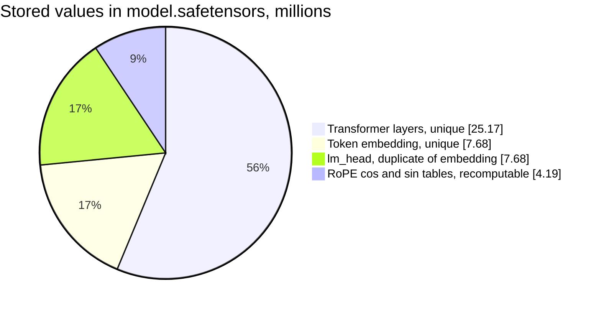
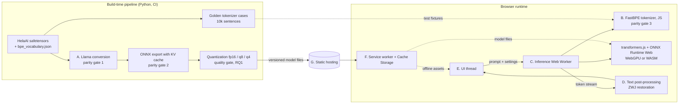
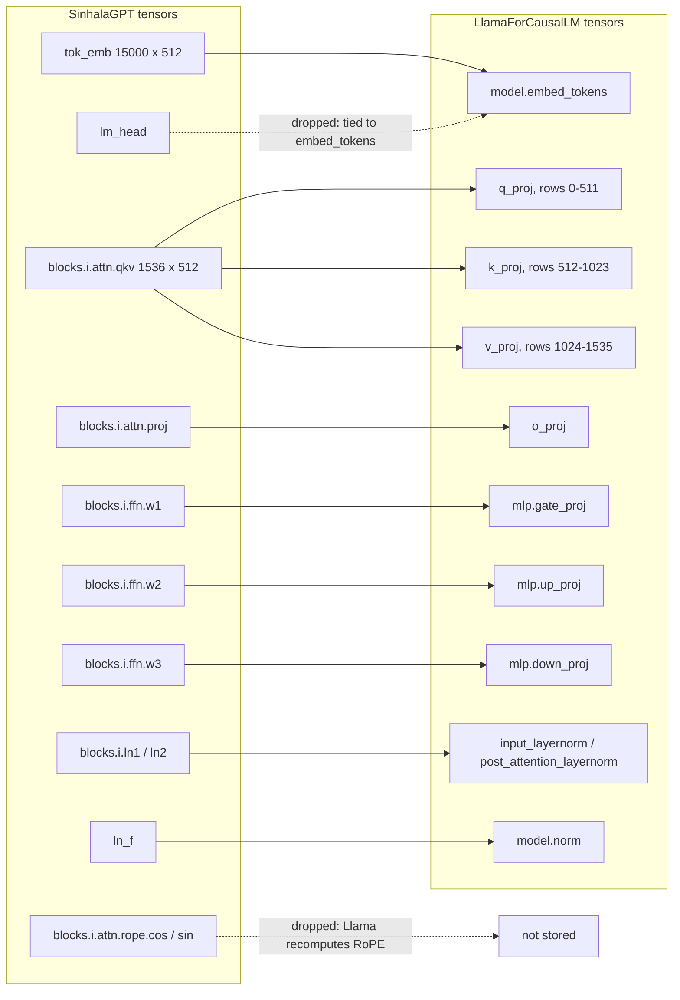
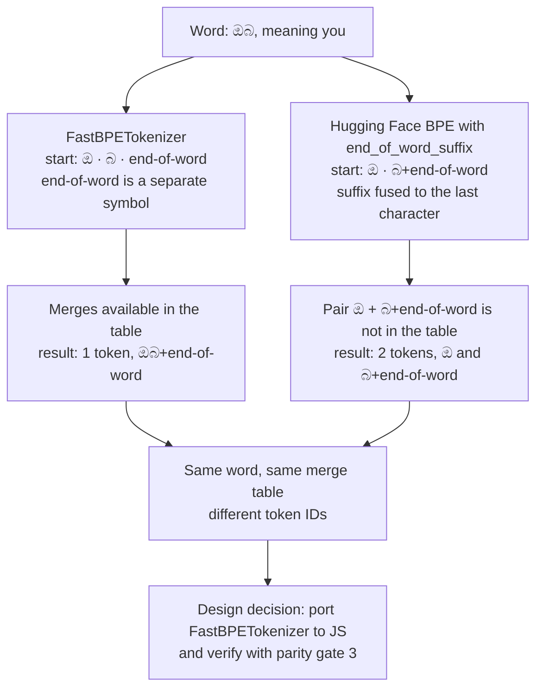
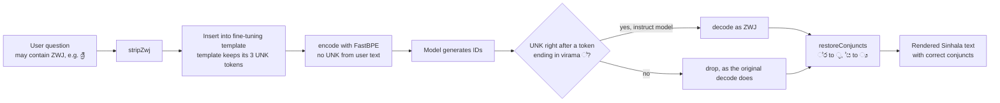
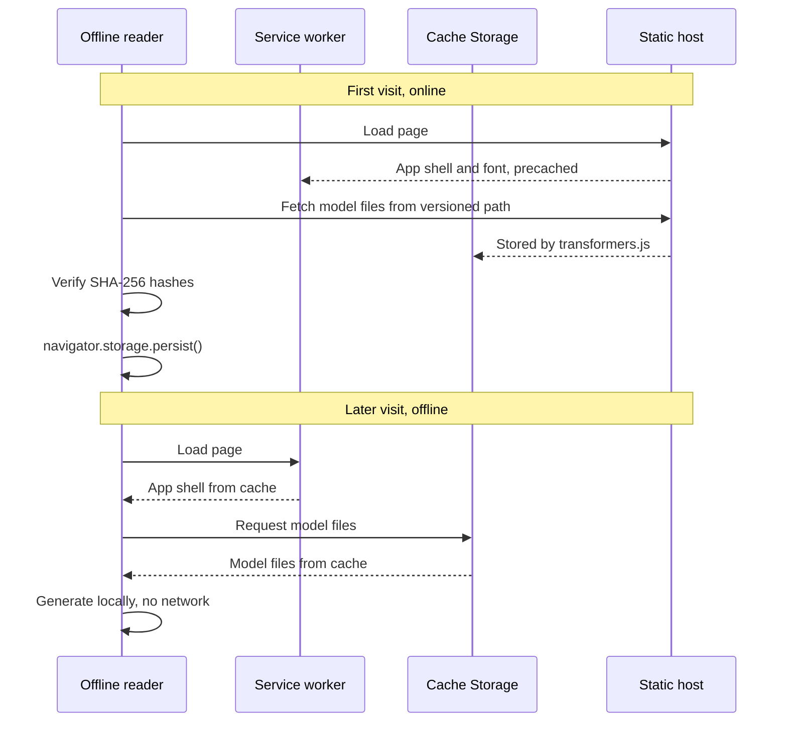
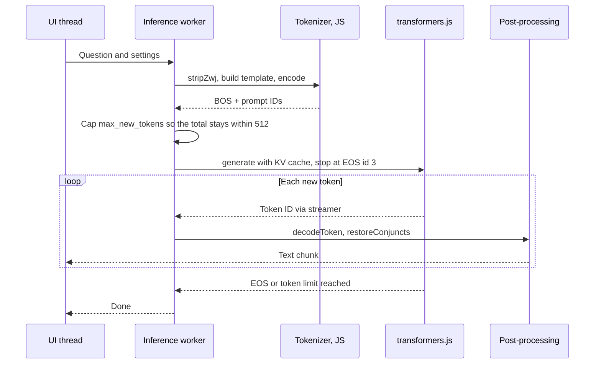
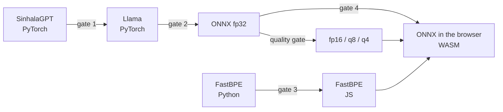
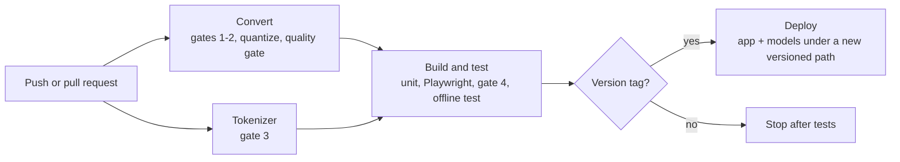

# End-to-End Fidelity in On-Device Language Models for Low-Resource Scripts: An Empirical Study of Sinhala in the Browser

*System design, implementation, testing and deployment plan for client-side Sinhala text generation and question answering*

---

### Abstract

For a long period of time, running a language model meant sending text to a server and waiting for a response. However, the combination of compact models, ONNX-based runtimes and WebGPU has begun to make it practical to run a model entirely inside a web browser, with no server and no network connection after the first download. HelaAI recently released SinhalaLM, a GPT-style Sinhala language model trained from scratch, together with an instruction-tuned question-answering variant. Both models are small (32.85M unique parameters), which makes them a strong candidate for client-side inference.

In this proposal, we present an end-to-end plan to run both SinhalaLM checkpoints offline in the browser. Before designing the system, we audited the two Hugging Face repositories and found that the architecture is mathematically equivalent to Llama. We verified this by converting the weights to `LlamaForCausalLM` and observed a maximum absolute logit difference of 0.00 against the original implementation, with identical greedy generations under key-value caching. Alongside this, the audit surfaced several issues that directly shape the design: a broken `tokenizer.json`, a zero-width joiner (ZWJ) that is mapped to `<UNK>` even inside the model's own prompt template, and a base-model repository that does not ship its model classes. The proposed system addresses each of these through a dedicated tokenizer port, explicit ZWJ handling and parity gates at every conversion step, and is evaluated on quantization quality, cross-device latency and offline behavior.

---

### 1. Introduction

Sinhala is spoken by over 20 million people, yet it remains comparatively under-served by mainstream multilingual language models. The common way to bring LLM capability to Sinhala has been continual pretraining of a large existing model, which requires substantial GPU memory and incurs high inference cost. SinhalaLM explores the opposite direction: a compact model sized to the Sinhala data actually available, and roughly 240× smaller than an 8B-parameter alternative.

A model of this size does not just reduce server cost, but opens the possibility of removing the server altogether. Consider a scenario where a reader opens a web page once on Wi-Fi, installs it to the home screen, and later asks a Sinhala question while having no connection at all. In this proposal, we use this **offline reader** as the running example, and every design decision is evaluated against whether it serves that reader.

Rather than treating the browser deployment as a packaging exercise, we treat it as a sequence of verifiable transformations. Each step (weight conversion, tokenization, ONNX export, quantization, in-browser execution) must reproduce the output of the previous step within a defined tolerance before the next step begins.

The objectives of this work are:

- To convert both SinhalaLM checkpoints into a standard, widely supported model format without any loss of fidelity.
- To build a browser application that runs text continuation (base model) and Sinhala question answering (instruct model) fully offline after the first load.
- To measure the trade-off between model size and quality across quantization levels.
- To measure load time, time to first token and generation speed across WebGPU and WebAssembly (WASM) backends on a range of devices.
- To evaluate whether the ZWJ information lost by the tokenizer can be recovered at decoding time.

The rest of this proposal is organized as follows. Section 2 summarizes the two models and the findings of our repository audit. Section 3 defines the research questions. Section 4 presents the system design, Section 5 the implementation plan, Section 6 the testing and evaluation strategy, and Section 7 the deployment plan. Section 8 covers risks, Section 9 the milestones and community sharing plan, and Section 10 concludes the proposal.

---

### 2. Background and Preliminary Findings

#### 2.1 The SinhalaLM models

**SinhalaLM-V.0.0.1** is a decoder-only causal language model trained from scratch on approximately 304 million Sinhala tokens. It uses 8 transformer layers, an embedding dimension of 512, 8 attention heads, a 15,000-token custom byte-pair encoding (BPE) tokenizer, Rotary Position Embeddings (RoPE), SwiGLU feed-forward blocks and RMSNorm, with the input embedding tied to the output head. It was trained on a single NVIDIA GeForce RTX 5090 in 4.97 hours. As a base model, it continues text rather than following instructions.

**SinhalaLM-V.0.0.1-it** is obtained by fully fine-tuning the base checkpoint on Sinhala question-answer data, using an Alpaca-style Sinhala prompt template with loss masked to the answer tokens. It was trained for 447 steps and reached a best validation loss of 2.381392 (perplexity 10.82). Given a question wrapped in the template, it generates a Sinhala answer and is intended for single-turn question answering, not open-ended chat.

Both model cards state that the models are intended for research and prototyping, not for production or high-stakes use, and that no safety filtering has been applied to outputs. Both use a custom architecture that is not loadable through the standard `transformers` `AutoModel` classes.

#### 2.2 Repository audit

Before designing the system, we inspected the configuration files, the safetensors headers, the tokenizer files, the shipped source code, the training logs and the sample generations of both repositories. Table 1 summarizes the findings and how each one affects the design.

*Table 1: Audit findings and their impact on the browser system.*

| # | Finding | Evidence | Design impact |
|---|---|---|---|
| F1 | Stored tensors total 44.72M, but unique trainable parameters are 32.85M. | Safetensors header: 25,169,920 (8 layers) + 7,680,000 (`tok_emb`) + 512 (`ln_f`) = 32,850,432. Extra: `lm_head` 7,680,000 + RoPE `cos`/`sin` tables 4,194,304 = 11,874,304. `torch.equal(lm_head, tok_emb)` returns `True`, and the stored RoPE tables match the recomputed ones. | The instruct card's explanation ("task-specific components") is incorrect; both checkpoints share the same structure. The browser model only needs 32.85M parameters, since the duplicate head and the RoPE tables are dropped during conversion. |
| F2 | The base repository's `modeling_sinhalalm.py` is a download-and-run script that imports `SinhalaGPT` from itself, so the card's loading code fails. | The file defines no model or tokenizer classes. The instruct repository's file contains the full classes. | Both checkpoints are loaded with the instruct repository's classes, which fit the base weights (identical tensor shapes). |
| F3 | `tokenizer.json` cannot be loaded. | The `tokenizers` library raises `Token 'න්</w>' out of vocabulary`; 5,814 of 14,811 merges reference tokens that are not in the vocabulary. In addition, Hugging Face BPE attaches the `</w>` suffix to the last character, while `FastBPETokenizer` treats `</w>` as a separate symbol, so even a repaired file would not reproduce the same IDs. | `FastBPETokenizer` with `bpe_vocabulary.json` is the single source of truth. The browser uses a JavaScript port of it, verified by parity tests (Section 5.4). |
| F4 | The zero-width joiner (U+200D) is mapped to `<UNK>`. | 0 of 15,000 vocabulary entries contain ZWJ. Encoding the instruct template yields 37 tokens, 3 of which are `<UNK>`; `ශ්‍රී` becomes `ශ්`, `<UNK>`, `ර`, `ී`. `decode()` drops `<UNK>`, which is why outputs show `ක්ර` instead of `ක්‍ර`. | Input normalization and output post-processing must handle ZWJ explicitly (Section 4.2, D). |
| F5 | The architecture is equivalent to Llama. | Rotate-half RoPE with θ = 10000 and head dimension 64; pre-norm RMSNorm; SwiGLU as `w3(silu(w1 x) * w2 x)`; no biases; 8 query and 8 key-value heads; tied embeddings. After converting to `LlamaForCausalLM`, the maximum absolute logit difference is 0.00 on four prompts and a random 512-token input, for both checkpoints, and 40-token greedy generations are identical with key-value caching. | The standard Llama export path (Optimum to ONNX, transformers.js runtime) can be used instead of a custom runtime. |
| F6 | The instruct model generates `<UNK>` where a ZWJ most likely belongs. | Across four greedy generations, the instruct model emitted 6 `<UNK>` tokens, 5 of which directly followed a token ending in the virama (`්`), in words such as `සත්ය`, `ප්රධාන` and `ක්රියාත්මක`. The base model emitted none. | Decoding `<UNK>` after a virama as ZWJ is a candidate recovery method, to be confirmed on a larger sample (RQ3). |
| F7 | The base configuration and the model card disagree. | `config.json` lists `block_size: 256` and `dropout: 0.3`; the card lists 512 and 0.2. Wall time × average throughput (17,878 s × 555,300 tokens/s = 9.93B tokens) matches 150,000 × 128 × 512 = 9.83B, which supports 512. | The browser model uses `max_position_embeddings = 512`, and the application caps prompt plus generation at 512 tokens. |
| F8 | Training was data-limited, and outputs are repetitive and carry dataset artifacts. | The base model saw each token about 32 times on average (9.83B / 304M). Validation loss plateaued (3.53 at step 19,000, best 3.39 at step 115,500, final 3.41) while training loss kept falling. Greedy outputs loop (`ඔබ ගුවන් යානා පදවන්නෙක් නම්` repeated), and instruct outputs contain ELI5-style artifacts such as `L;L2` and `&`. | The application exposes a repetition penalty and shows a clear notice that outputs are unverified. |
| F9 | The license section is placeholder text, and the cards describe the repositories as private while they are public. | Both licenses read "Update this section with your actual terms ... before granting access to others." Example code refers to `ChamaraVishwajithRajapaksha/...` repository IDs. | Publishing converted weights requires permission from the HelaAI authors (Section 5.1). Code uses the `HelaAI/...` IDs. |

Figure 1 breaks down F1. More than a quarter of the stored values are either a duplicate or a table that can be recomputed, which is why the converted model is smaller than the published file.



*Figure 1: Composition of the 44.72M stored values, which illustrates that only 32.85M are unique trainable parameters (the 512 values of `ln_f` are too small to show).*

In other words, the audit changes the project from "port a custom model" into "export a Llama model and get the tokenizer exactly right". This is because F5 removes most of the runtime engineering, while F3 and F4 move the risk into text handling, which is where a Sinhala-specific system is most likely to fail.

The conversion and parity check behind F1, F5 and F6 is provided as `tools/parity_check.py` and can be reproduced on a CPU.

---

### 3. Research Questions

Since the application itself is an engineering artifact, we frame the measurable parts of the work as research questions. This ensures that the results can be reported, compared and reproduced by others.

- **RQ1 (Quantization):** How does perplexity on held-out Sinhala text change across fp32, fp16, int8 (q8) and 4-bit (q4) variants, and what is the smallest variant whose quality stays within an acceptable margin of fp32?
- **RQ2 (Latency):** How do download size, cold and warm load time, time to first token and generation speed differ between the WebGPU and WASM backends across desktop and mobile devices? For a model of this size, does WebGPU provide a measurable advantage over multi-threaded WASM?
- **RQ3 (ZWJ recovery):** Can the ZWJ lost during tokenization be recovered at decoding time, by decoding `<UNK>` after a virama as ZWJ for the instruct model (F6), and by rule-based restoration of rakaransaya and yansaya for both models? How often do native speakers judge the restored text as correct?

---

### 4. System Design

#### 4.1 Requirements

**Functional requirements**

- **FR1** — Text continuation with the base model, from a user prompt or from `<BOS>`.
- **FR2** — Single-turn Sinhala question answering with the instruct model, using the exact fine-tuning template.
- **FR3** — Token-by-token streaming of the output.
- **FR4** — User control over temperature, top-k, repetition penalty and maximum new tokens.
- **FR5** — Full offline operation after the first successful load, including after a browser restart.
- **FR6** — Correct rendering of Sinhala text, including restored conjuncts.

**Non-functional requirements**

- **NFR1 (Privacy)** — No user text leaves the device. The application sends no analytics by default.
- **NFR2 (Fidelity)** — Every conversion step passes its parity gate (Section 6).
- **NFR3 (Responsiveness)** — Inference never blocks the user interface thread.
- **NFR4 (Portability)** — The application runs on WebGPU where available and falls back to WASM everywhere else.
- **NFR5 (Footprint)** — Total download size and peak memory fit mid-range phones. `[[NEEDS INPUT: target device list and acceptable download size]]`
- **NFR6 (Transparency)** — The interface states the model's intended use and limitations as given in the model cards.

#### 4.2 Architecture overview

The system has two halves. A **build-time pipeline** runs once in Python and produces verified, quantized ONNX artifacts. A **runtime application** runs entirely in the browser and consumes those artifacts.



*Figure 2: End-to-end architecture which demonstrates how verified model artifacts flow from the build-time pipeline into an offline browser runtime.*

The components are described below.

**A) Model conversion pipeline.** This component maps each SinhalaGPT tensor to its Llama equivalent: the fused `qkv` weight is split into `q_proj`, `k_proj` and `v_proj`, `w1`, `w2` and `w3` become `gate_proj`, `up_proj` and `down_proj`, and the duplicate `lm_head` and RoPE tables are dropped (F1, F5). In the context of our offline reader, this step matters because the reader downloads only the 32.85M parameters that carry information, not the 44.72M stored values.



*Figure 3: Tensor mapping from SinhalaGPT to LlamaForCausalLM, which illustrates how the fused attention projection is split and why only 32.85M parameters remain after conversion.*

**B) Tokenizer module.** This is a JavaScript port of `FastBPETokenizer`. It splits on whitespace, represents each word as its characters followed by a separate `</w>` symbol, and repeatedly merges the adjacent pair with the lowest priority. Rather than relying on the published `tokenizer.json` (F3), it reads `bpe_vocabulary.json` directly, so that the browser produces exactly the token IDs the model was trained on.

*Example 1: how a word is merged.* Consider the word සිංහලෙන් ("in Sinhala"). The tokenizer first splits it into its eight code points followed by a separate `</w>` symbol. At every step, it looks at all adjacent pairs and merges the one with the lowest rank in the merge table:

| Step | Merge rank | Symbols after the step |
|---|---|---|
| Start | — | ස · ි · ං · හ · ල · ෙ · න · ් · `</w>` |
| 1 | 0 | ස · ි · ං · හ · ල · ෙ · න · `්</w>` |
| 2 | 20 | සි · ං · හ · ල · ෙ · න · `්</w>` |
| 3 | 109 | සි · ං · හ · ලෙ · න · `්</w>` |
| 4 | 328 | සිං · හ · ලෙ · න · `්</w>` |
| 5 | 461 | සිංහ · ලෙ · න · `්</w>` |

The interesting step is the first one. Both (න, ්) with rank 1 and (්, `</w>`) with rank 0 are available, and the virama joins the end-of-word symbol first. As a result, න can never join it, and the word ends in two separate tokens, න and `්</w>`. The same pattern appears in ආයුබෝවන්, which becomes ආ · යු · බෝ · වන · `්</w>`. In other words, the end-of-word symbol takes part in the competition between merges, and the JavaScript port must reproduce this behavior exactly.

*Example 2: punctuation stays attached.* The tokenizer splits words only on whitespace, so punctuation stays part of the word. The question word කුමක්ද? ("what?") becomes a single token, `කුමක්ද?</w>`, while කුමක්ද ? with a space becomes four tokens: කු · ම · `ක්ද</w>` · `?</w>`. The published `tokenizer.json` uses the Hugging Face `Whitespace` pre-tokenizer, which separates punctuation from words, so it would never produce the token `කුමක්ද?</w>` that the model saw during training.

Figure 4 explains why a repaired `tokenizer.json` would still not be enough. The two implementations start the merge process from different symbol sequences, so the same merge table can lead to different tokens. Consider the common word ඔබ ("you"). FastBPETokenizer starts from ඔ · බ · `</w>` and merges it into a single token, `ඔබ</w>`. The Hugging Face convention starts from ඔ · `බ</w>`, and since the merge table contains no pair (ඔ, `බ</w>`), the word stays as two tokens.



*Figure 4: Tokenization of the word ඔබ under the two starting conventions, which demonstrates why the browser must reproduce FastBPETokenizer exactly rather than load tokenizer.json.*

To estimate how often this happens, we replayed the same merge table under both starting conventions on the 9,188 Sinhala whole-word vocabulary entries of two or more characters. 463 of them (5.0%) were tokenized differently. This is a simulation of the Hugging Face convention rather than a run of the Hugging Face library itself, since the published file cannot be loaded, but it shows that the difference affects common words and not only rare edge cases.

**C) Inference worker.** A dedicated Web Worker loads the model through transformers.js, selects the WebGPU or WASM backend, runs generation and streams tokens back. This ensures that the page stays responsive while the model generates (NFR3).

**D) Text post-processing.** This component handles ZWJ in both directions (F4):

- **Input:** ZWJ is removed from user text before encoding, since the pretraining corpus kept only the Sinhala block (U+0D80–U+0DFF) and the model has never seen ZWJ as a meaningful symbol. The instruct template is kept exactly as it was used in fine-tuning, including the `<UNK>` tokens it produces, because that is the sequence the model learned to continue.
- **Output, instruct model:** `<UNK>` directly after a token ending in a virama is decoded as ZWJ (F6, RQ3).
- **Output, both models:** a rule-based pass restores rakaransaya (`්ර` → `්‍ර`) and yansaya (`්ය` → `්‍ය`). These rules have edge cases, so they are evaluated by native speakers (RQ3) and can be switched off in settings.

The following examples, all taken from the actual tokenizer and model outputs, show what each step does.

*Example 3: why ZWJ is removed from the input.* Consider a user who types ශ්‍රී correctly, with a ZWJ. The tokenizer produces four tokens, ශ් · `<UNK>` · ර · `ී</w>`, because ZWJ is not in the vocabulary. After `stripZwj`, the same word is typed as ශ්රී and produces three tokens, ශ · ්ර · `ී</w>`, with no `<UNK>`. This is because the pretraining corpus contained conjuncts without ZWJ, and the vocabulary learned them in that form (608 vocabulary entries contain the sequence `්ර`). In the context of our offline reader, removing ZWJ means the question reaches the model in the same form as its training data.

*Example 4: why the template keeps its `<UNK>` tokens.* The template word ප්‍රශ්නය ("question") encodes as ප් · `<UNK>` · රශ් · `නය</w>`. Since the instruct model was fine-tuned on exactly this sequence, removing the ZWJ from the template would give the model a prompt it never saw during training.

*Example 5: why `<UNK>` is silently lost on decoding.* The original `decode()` removes `<UNK>` together with the other special tokens. As a result, the four tokens of ප්‍රශ්නය decode as ප්රශ්නය, which explains why the published sample outputs show ක්ර instead of ක්‍ර.

*Example 6: recovering ZWJ from `<UNK>`.* In the greedy outputs of the instruct model, `<UNK>` appeared in sequences such as සත් · `<UNK>` · `ය</w>`, ප් · `<UNK>` · `රධාන</w>` and ක් · `<UNK>` · ර · ිය. In each case, the previous token ends in a virama, so the decoder emits ZWJ and produces සත්‍ය, ප්‍රධාන and ක්‍රිය. On the other hand, the output also contained L · `<UNK>` · `2</w>`, where the previous token does not end in a virama. Here, the decoder drops `<UNK>` as before and produces L2. This is the reason the rule checks the previous token rather than decoding every `<UNK>` as ZWJ.

*Example 7: rule-based restoration for the base model.* The base model did not generate `<UNK>` in our test generations, which is consistent with a pretraining corpus that contained no ZWJ. For its outputs, the rule-based pass rewrites ප්රධාන as ප්‍රධාන and සත්ය as සත්‍ය.



*Figure 5: ZWJ handling across input and output, which represents how information lost by the tokenizer is removed before encoding and recovered after decoding.*

**E) User interface.** The interface provides two modes (Continue text and Ask a question), generation settings, a model variant selector, a load progress indicator and a limitations notice. A Sinhala font (Noto Sans Sinhala) is bundled locally, so that conjuncts render correctly without a network connection.

**F) Offline layer.** A service worker caches the application shell, and transformers.js stores model files in the browser's Cache Storage. The application also requests persistent storage through `navigator.storage.persist()`, which reduces the chance that the browser evicts the model under storage pressure. In other words, the offline reader depends on two caches: one for the page and one for the model.



*Figure 6: First online visit and later offline visit, which demonstrates how the page cache and the model cache together enable FR5.*

**G) Static hosting.** Model files are served under versioned paths (for example, `/models/sinhalalm-it/v0.0.1/`), so that a model update never mixes files from two versions inside the reader's cache.

#### 4.3 Request lifecycle

When the offline reader asks a question, the request flows through the system as follows:

1. The UI thread sends the question and settings to the worker.
2. The worker removes ZWJ from the question, builds the prompt with the fine-tuning template, and encodes it as `[<BOS>] + encode(prompt)`.
3. The worker checks that the prompt plus `max_new_tokens` does not exceed 512 tokens (F7), and reduces `max_new_tokens` if necessary.
4. transformers.js runs generation with key-value caching, stopping at `<EOS>` (ID 3).
5. Each new token is decoded incrementally, passed through the ZWJ restoration step and streamed to the UI.



*Figure 7: Request lifecycle of a single question, which illustrates how tokenization, generation and post-processing stay inside the worker while the UI only receives text.*

#### 4.4 Key design decisions

**Llama export instead of a custom runtime.** Instead of exporting the original SinhalaGPT graph and writing a generation loop by hand, we export the converted Llama model. This choice is quite reasonable because F5 shows bit-exact equivalence, and the Llama path provides key-value caching, sampling and quantization tooling that is already maintained. The downside of this approach would be a dependency on transformers.js and Optimum versions, which we mitigate by pinning versions (Section 8). The custom-graph path (`torch.onnx.export` of SinhalaGPT with `onnxruntime-web`) is kept as a fallback.

**Own tokenizer instead of transformers.js tokenizers.** Since the Hugging Face tokenizer format cannot reproduce the `</w>` handling of `FastBPETokenizer` (F3), the application calls `model.generate()` with input IDs produced by its own tokenizer. The cost is roughly 60 lines of JavaScript and a parity test suite; the benefit is exact agreement with training-time tokenization.

**Web Worker instead of main-thread inference.** Even a small model can block the UI thread for hundreds of milliseconds per step on a slow phone. Running inference in a worker keeps typing and scrolling responsive.

**Self-hosted model files instead of fetching from the Hub at runtime.** Setting `env.allowRemoteModels = false` and serving files from the same origin means the runtime contacts no third party, which aligns with NFR1 and makes offline behavior predictable. This depends on permission to redistribute the converted weights (F9).

---

### 5. Implementation Plan

#### 5.1 Phase 0: Permission and scope

The license sections of both repositories are placeholders (F9). Before publishing converted weights, we contact the HelaAI authors to ask for permission, or offer to contribute the ONNX artifacts to their repositories through a pull request. The audit findings F1–F4 and F7 are shared with them at the same time, since each one is a small fix on their side.

`[[NEEDS INPUT: permission status from the HelaAI authors]]`

#### 5.2 Phase 1: Reference outputs

We load both checkpoints with the instruct repository's classes (F2) and store golden outputs:

- logits for a fixed set of prompts, including the instruct template;
- 40-token greedy generations for the same prompts;
- perplexity on a held-out Sinhala set. We propose the FLORES+ `sin_Sinh` devtest split (1,012 sentences) for this purpose.

#### 5.3 Phase 2: Llama conversion (parity gate 1)

The conversion maps tensors as described in Section 4.2 (A). The configuration below reproduces the original model exactly:

```python
cfg = LlamaConfig(
    vocab_size=15000, hidden_size=512, intermediate_size=1365,
    num_hidden_layers=8, num_attention_heads=8, num_key_value_heads=8,
    max_position_embeddings=512, rope_theta=10000.0,
    rms_norm_eps=torch.finfo(torch.float32).eps,  # nn.RMSNorm(eps=None) default
    tie_word_embeddings=True, attention_bias=False, mlp_bias=False,
    bos_token_id=2, eos_token_id=3, pad_token_id=0,
)
```

Two details are easy to get wrong. First, the original model uses `nn.RMSNorm` without an explicit epsilon, which defaults to the machine epsilon of the data type (about 1.19e-7 for float32), while Llama configurations usually use 1e-5. Second, `intermediate_size` is 1365, which comes from `int(512 * 8 / 3)`.

The full conversion and gate are implemented in `tools/parity_check.py`. The gate passes when the maximum absolute logit difference is below 1e-4 and all greedy generations are identical. Both checkpoints currently pass with a difference of 0.00. The script also writes a `generation_config.json` alongside the model through `save_pretrained`, which we update with `eos_token_id = 3` and default sampling settings.

#### 5.4 Phase 3: Tokenizer port (parity gate 3)

The JavaScript tokenizer mirrors the Python implementation step by step:

```js
// Python's str.isspace() set: JavaScript's \s without U+FEFF, plus U+001C-U+001F and U+0085
const PY_WHITESPACE = /[\t\n\v\f\r \x1c-\x1f\x85\xa0  - 

  　]+/;

export class FastBPETokenizer {
  constructor({ stoi, itos, merges, merge_priority }) {
    this.stoi = stoi;
    this.itos = new Map(Object.entries(itos).map(([k, v]) => [Number(k), v]));
    this.rank = new Map(Object.entries(merge_priority)); // "a|||b" -> rank
    this.merged = new Map(Object.entries(merges));       // "a|||b" -> "ab"
    this.cache = new Map();
  }

  tokenizeWord(word) {
    const hit = this.cache.get(word);
    if (hit) return hit;
    const sym = [...word, "</w>"];  // code points, like Python's list(word)
    while (sym.length > 1) {
      let best = -1, bestRank = Infinity;
      for (let i = 0; i < sym.length - 1; i++) {
        const r = this.rank.get(`${sym[i]}|||${sym[i + 1]}`);
        if (r !== undefined && r < bestRank) { bestRank = r; best = i; }  // strict <: first wins, as in Python
      }
      if (best < 0) break;
      sym.splice(best, 2, this.merged.get(`${sym[best]}|||${sym[best + 1]}`));
    }
    this.cache.set(word, sym);
    return sym;
  }

  encode(text) {
    const unk = this.stoi["<UNK>"] ?? 1;
    return text.split(PY_WHITESPACE).filter(Boolean)  // same split points as Python's str.split()
      .flatMap((w) => this.tokenizeWord(w).map((t) => this.stoi[t] ?? unk));
  }

  decodeToken(id, prevId, { unkAsZwj = false } = {}) {
    const tok = this.itos.get(id) ?? "<UNK>";
    if (tok === "<UNK>") {
      const prev = this.itos.get(prevId) ?? "";
      return unkAsZwj && prev.endsWith("්") ? "\u200D" : "";  // F6
    }
    if (["<PAD>", "<BOS>", "<EOS>"].includes(tok)) return "";
    return tok.replace("</w>", " ");
  }
}
```

*Example 8: whitespace is not the same in both languages.* The port must split text exactly where Python's `str.split()` does, but JavaScript's `\s` disagrees with Python on a few characters:

| Character | Python `str.split()` | JavaScript `\s` |
|---|---|---|
| U+FEFF (byte order mark) | not whitespace | whitespace |
| U+001C–U+001F (information separators) | whitespace | not whitespace |
| U+0085 (next line) | whitespace | not whitespace |

Consider a question copied from a document that starts with a byte order mark. Python keeps the mark inside the first word, where it becomes an extra `<UNK>` token, while a naive JavaScript port would treat it as a space and drop it. The two encodings would then differ by one token, and the model would see a different prompt in the browser than in Python. For this reason, the port uses the `PY_WHITESPACE` character class shown above, which we verified against Python's `str.isspace()` on all 65,536 characters of the Basic Multilingual Plane with no mismatches.

The parity test encodes 10,000 Sinhala sentences in Python and in Node.js and requires identical ID arrays. Alongside random sentences, the test set deliberately includes the cases from Examples 1–8: words where the end-of-word symbol wins a merge (සිංහලෙන්), punctuation attached to words (කුමක්ද?), common words affected by the starting convention (ඔබ), ZWJ, English words, digits, the whitespace characters in the table above and empty input.

As an early check, we ran the port exactly as listed above against the Python implementation on 3,010 inputs: the cases from Examples 1–8 plus 3,000 random sequences of vocabulary tokens joined with mixed whitespace. All 3,010 encodings matched, and `decodeToken` returned ZWJ for `<UNK>` after සත් and an empty string for `<UNK>` after L. The full 10,000-sentence gate remains part of the CI pipeline.

#### 5.5 Phase 4: ONNX export and quantization (parity gate 2)

The converted model is exported with key-value caching, using the Optimum ONNX exporter:

```bash
optimum-cli export onnx --model ./sinhalalm-it-llama --task text-generation-with-past ./export/sinhalalm-it
```

The exported model is then quantized into fp16, q8 and q4 (4-bit, MatMulNBits) variants, using the quantization script in the transformers.js repository, so that the files follow the `onnx/` folder layout and naming that transformers.js expects. Parity gate 2 compares the fp32 ONNX model with the PyTorch reference, using the same tolerance as gate 1.

The expected download sizes are derived from the 32.85M unique parameters:

| Variant | Lower bound | If the embedding table stays fp32 |
|---|---|---|
| fp32 | 131.4 MB | 131.4 MB |
| fp16 | 65.7 MB | 65.7 MB |
| q8 | 32.9 MB | about 63.6 MB |
| q4 | 16.4 MB | about 47.1 MB |

The right-hand column reflects a practical consideration. Quantization tools typically quantize matrix multiplications but leave the embedding lookup in full precision, and the tied 15,000 × 512 embedding is 23% of all parameters. As a result, the actual q8 and q4 files may be noticeably larger than the lower bound, and the real sizes are recorded as part of RQ1.

#### 5.6 Phase 5: Quality evaluation before the UI (RQ1)

For each variant, we compute perplexity on the held-out set with ONNX Runtime in Python (for example, through `ORTModelForCausalLM` with the variant's file name), together with the greedy agreement rate against fp32 on the golden prompts. The shipped default is the smallest variant whose perplexity stays within 2% of fp32. Since the browser application is built only after this step, a variant that fails here never reaches the reader.

#### 5.7 Phase 6: Browser application

The application is built with Vite, with the inference code in a Web Worker. The worker core is shown below:

```js
import { AutoModelForCausalLM, Tensor, env } from "@huggingface/transformers";

env.allowRemoteModels = false;
env.localModelPath = "/models/";

const device = (navigator.gpu && (await navigator.gpu.requestAdapter())) ? "webgpu" : "wasm";
const model = await AutoModelForCausalLM.from_pretrained("sinhalalm-it/v0.0.1", { device, dtype: "q8" });

async function answer(question, opts, onText) {
  const ids = [2, ...tokenizer.encode(buildPrompt(stripZwj(question)))];
  const maxNew = Math.min(opts.maxNewTokens, 512 - ids.length);  // F7
  const input_ids = new Tensor("int64", BigInt64Array.from(ids, BigInt), [1, ids.length]);
  const attention_mask = new Tensor("int64", new BigInt64Array(ids.length).fill(1n), [1, ids.length]);

  let prev = ids.at(-1), first = true;
  const streamer = {
    put(value) {
      if (first) { first = false; return; }  // the first call carries the prompt
      for (const id of value.flat().map(Number)) {
        onText(restoreConjuncts(tokenizer.decodeToken(id, prev, { unkAsZwj: true })));
        prev = id;
      }
    },
    end() {},
  };

  await model.generate({
    input_ids, attention_mask, max_new_tokens: maxNew, eos_token_id: 3,
    do_sample: true, temperature: opts.temperature, top_k: opts.topK,
    repetition_penalty: opts.repetitionPenalty, streamer,
  });
}
```

The streamer interface and the shape of the values passed to `put()` should be checked against the pinned transformers.js version, since they have changed between releases. Since `restoreConjuncts` operates token by token, a conjunct split across two tokens is handled by keeping the last character of each chunk in a small buffer until the next token arrives.

The offline layer is added with `vite-plugin-pwa` (Workbox), which caches the application shell and the bundled font and makes the application installable. Model files stay in the transformers.js cache, and the application calls `navigator.storage.persist()` after the first successful load.

#### 5.8 Project structure

```
sinhalalm-web/
├── convert/                  # Python, build time
│   ├── parity_check.py       # gate 1 (provided as tools/parity_check.py)
│   ├── export_onnx.sh        # Optimum export
│   ├── quantize.sh           # fp16 / q8 / q4
│   ├── eval_quality.py       # gate 2 + RQ1 perplexity
│   └── make_golden.py        # golden logits + tokenizer cases
├── golden/                   # fixtures shared by Python and JS tests
├── web/
│   ├── src/tokenizer/fastbpe.js
│   ├── src/text/zwj.js       # stripZwj, restoreConjuncts
│   ├── src/worker/inference.worker.js
│   ├── src/ui/
│   ├── public/models/<model>/<version>/
│   └── tests/                # Vitest unit tests, Playwright E2E
└── .github/workflows/
```

---

### 6. Testing and Evaluation

The testing strategy follows the chain of transformations. Each gate compares a step with the step before it, so that a failure always points to one component.

#### 6.1 Parity gates



*Figure 8: Chain of parity gates, which demonstrates how each transformation is verified against the previous one so that a failure always points to a single component.*

| Gate | Compares | Pass criterion |
|---|---|---|
| 1 | SinhalaGPT (PyTorch) vs Llama (PyTorch) | max \|logit diff\| < 1e-4 and identical greedy output (currently 0.00, passing) |
| 2 | Llama (PyTorch) vs ONNX fp32 | max \|logit diff\| < 1e-4 and identical greedy output |
| 3 | `FastBPETokenizer` (Python) vs JS port | identical IDs on 10,000 sentences |
| 4 | ONNX fp32 in Python vs in the browser (WASM) | identical greedy output on golden prompts |
| Quality | Quantized vs fp32 | perplexity within 2% of fp32 |

Gate 4 runs the golden prompts in a headless browser and compares the output token IDs with the Python results, which confirms that the browser runtime adds no drift of its own.

#### 6.2 Unit and integration tests

- **Tokenizer** (Vitest): golden cases from gate 3, round-trip behavior and caching, with named regression cases taken from the examples in Sections 4.2 and 5.4:
  - සිංහලෙන් → සිංහ · ලෙ · න · `්</w>` (the end-of-word symbol wins the first merge);
  - කුමක්ද? → one token, and කුමක්ද ? → four tokens (punctuation stays attached);
  - ඔබ → one token, `ඔබ</w>` (the case that breaks the Hugging Face convention);
  - ශ්‍රී → four tokens including `<UNK>`, and ශ්රී → three tokens with no `<UNK>`;
  - the instruct template → 37 tokens, with `<UNK>` at exactly three positions;
  - text starting with a byte order mark → the same IDs as Python.
- **ZWJ module**: `stripZwj` on mixed input, `restoreConjuncts` on a curated list of rakaransaya and yansaya words (for example, ප්රධාන → ප්‍රධාන and සත්ය → සත්‍ය), and the token-boundary buffer. `decodeToken` is tested on both sides of the rule: `<UNK>` after සත් must become ZWJ, while `<UNK>` after L must be dropped.
- **Prompt builder**: byte-for-byte equality with the Python `build_prompt` output.
- **Context limit**: prompts close to 512 tokens never exceed the limit after generation.

#### 6.3 End-to-end tests

End-to-end tests run with Playwright in Chromium using the WASM backend, since WebGPU is generally unavailable in headless CI runners. The suite covers the first load with a progress indicator, question answering with streaming, settings changes, and the offline scenario: after the first load, the test switches the browser context offline with `context.setOffline(true)`, reloads the page and confirms that generation still works. This test is the automated version of our offline reader.

#### 6.4 Cross-device benchmarks (RQ2)

WebGPU behavior varies by device and driver, so benchmarks run on physical devices rather than in CI. For each device and backend, we record:

- download size and cold load time (empty cache);
- warm load time (from cache);
- time to first token;
- generation speed in tokens per second;
- peak memory.

The protocol uses a fixed prompt, greedy decoding, 128 new tokens and the median of five runs. The application includes a benchmark page that runs this protocol and shows the results with a "copy results" button, so that community members can voluntarily contribute measurements from their own devices.

`[[NEEDS INPUT: devices available for benchmarking]]`

#### 6.5 Human evaluation (RQ3)

ZWJ restoration and answer quality are judged by native Sinhala speakers. For RQ3, raters see the same output with and without restoration and mark which rendering is correct. A larger generation sample is also used to confirm or reject the `<UNK>`-after-virama pattern observed in F6.

`[[NEEDS INPUT: number of raters and sample size]]`

#### 6.6 Acceptance criteria

The application is ready for release when all parity gates pass, the selected variant passes the quality gate, the offline end-to-end test passes, and the benchmark results meet the targets for the chosen devices.

`[[NEEDS INPUT: performance targets, for example time to first token and tokens per second on a mid-range phone]]`

---

### 7. Deployment

#### 7.1 Hosting options

Multi-threaded WASM requires `SharedArrayBuffer`, which browsers only enable on cross-origin isolated pages. This makes the response headers `Cross-Origin-Opener-Policy: same-origin` and `Cross-Origin-Embedder-Policy: require-corp` (or `credentialless`) a hard requirement for good WASM performance, and the choice of host follows from it.

| Host | Custom headers | Large model files | Notes |
|---|---|---|---|
| Hugging Face static Space | Yes, through the Space configuration | Yes | Close to the models' home; a natural place to share with the Hugging Face community. |
| Cloudflare Pages | Yes, through a `_headers` file | Per-file size limit (25 MiB) | Model files would need separate storage (for example, R2) with CORS enabled. |
| GitHub Pages | No | Repository size limits apply | Needs `coi-serviceworker` to emulate isolation, which must then be merged with the PWA service worker, since only one service worker can control a scope. |

We propose a Hugging Face static Space as the primary host, since it supports the required headers and large files without workarounds. The header configuration should be confirmed against the current Spaces documentation.

`[[NEEDS INPUT: final hosting choice]]`

#### 7.2 CI/CD pipeline

The pipeline runs on GitHub Actions in four jobs:

1. **Convert**: runs the conversion, parity gates 1 and 2, quantization and the quality gate on a CPU runner, and uploads the model artifacts.
2. **Tokenizer**: generates golden cases in Python and runs the JavaScript parity test in Node.js.
3. **Build and test**: builds the web application and runs unit and Playwright tests, including gate 4 and the offline test.
4. **Deploy**: on a version tag, publishes the application and the model files under a new versioned path.



*Figure 9: CI/CD pipeline, which represents how every release passes all gates before it reaches the static host.*

#### 7.3 Versioning and integrity

Each release pins the transformers.js, Optimum, ONNX Runtime and PyTorch versions used to produce it, and writes a manifest with the SHA-256 hash of every model file. The application verifies the hashes after download, which detects corrupted or partially cached files before they reach the reader. Since model files live under versioned paths, a new release downloads the new files once and the old cache entries are deleted after the switch.

#### 7.4 Privacy and responsible use

All inference happens on the device, and the application sends no analytics. The interface states the intended use from the model cards: research and prototyping, outputs that may be fluent but factually incorrect, and no suitability for medical, legal or financial questions. It also credits the HelaAI authors and links to both model cards.

---

### 8. Risks and Mitigations

| Risk | Impact | Mitigation |
|---|---|---|
| No permission to redistribute converted weights (F9) | Self-hosting is blocked | Contribute ONNX files to the HelaAI repositories, or publish only the conversion code and let users convert locally. |
| Tokenizer drift between Python and JS (F3) | Silent quality loss | Parity gate 3 on 10,000 sentences, run in CI on every change. |
| Version incompatibility between transformers and the ONNX exporter | Export fails | Pin a known-compatible transformers version for the export job; keep the custom-graph fallback. |
| Quantized variants degrade quality | Poor answers | Quality gate before the UI; ship fp16 if q8 and q4 fail. |
| Embedding left in fp32 increases size | Larger download than estimated | Measure real sizes; evaluate quantizing the embedding as a separate experiment. |
| WebGPU unavailable or unstable | Slower generation | Automatic WASM fallback with cross-origin isolation for multi-threading. |
| Storage eviction on mobile | Offline mode fails | `navigator.storage.persist()`, hash checks and a clear re-download prompt. |
| Low-quality or repetitive outputs (F8) | User trust | Repetition penalty, limitations notice and correct framing of the model as a research prototype. |
| ZWJ restoration rules are wrong for some words | Incorrect rendering | Native-speaker evaluation (RQ3) and a setting to disable restoration. |

---

### 9. Milestones and Community Sharing

The work is organized into four milestones. Each milestone ends with a result that can be shared with the community on its own.

| Milestone | Scope | Shareable result |
|---|---|---|
| M1 | Phases 0–2: permission, reference outputs, Llama conversion | The audit findings and the bit-exact Llama equivalence |
| M2 | Phases 3–5: tokenizer port, ONNX export, quantization | The size versus quality chart (RQ1) |
| M3 | Phase 6 and Section 6: application, tests, offline mode | A demo of question answering in airplane mode |
| M4 | Section 7 and benchmarks | The cross-device latency results (RQ2), the ZWJ recovery results (RQ3) and the public link |

`[[NEEDS INPUT: available time per week and target dates for each milestone]]`

---

### 10. Conclusion

Throughout this proposal, we presented an end-to-end plan for running SinhalaLM offline in the browser. We began with an audit of the two HelaAI repositories, which showed that the architecture is equivalent to Llama, which we verified with a bit-exact conversion, and that the main risks lie in tokenization and ZWJ handling rather than in the model itself. We then designed a system that separates a verified build-time pipeline from a browser runtime, with a dedicated tokenizer port, explicit ZWJ handling and a parity gate at every transformation. Finally, we defined the testing, deployment and evaluation plan that turns the application into measurable results on quantization quality, cross-device latency and ZWJ recovery.

In the context of our offline reader, the outcome is a Sinhala question-answering page that works with no server and no connection after its first load, built on a model that was designed to be small enough for exactly this kind of deployment.
